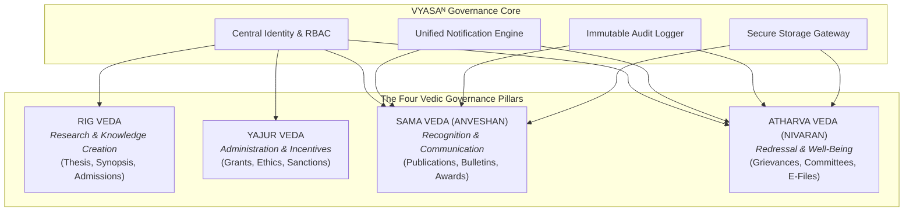
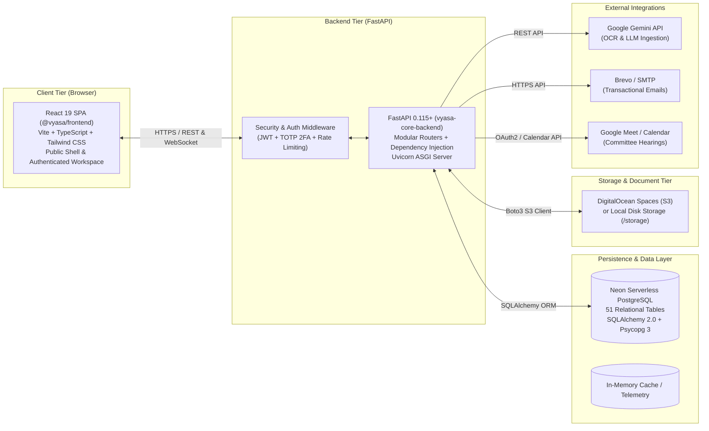

# VYASA-N — PLATFORM OVERVIEW & ARCHITECTURAL FOUNDATION

**Platform Title:** Vedic Yield & Academic Synthesis Architecture (VYASAᴺ)  
**Host Institution:** Chhatrapati Shahu Ji Maharaj University (CSJMU), Kanpur  
**Target Environment:** Cloud-Native Modular Monolith (Render / Docker / PostgreSQL)  

---

## 1. Vision & Core Objectives

VYASA-N was initiated by CSJMU leadership to overcome the pervasive challenges of fragmented institutional software, departmental data silos, manual paper-based grievance processing, and untracked research outputs.

### Institutional Problems Addressed:
1. **Grievance Latency & Opacity:** Student grievances historically traversed paper files across various administrative desks without definitive service level agreements (SLAs), leading to lost files, prolonged delays, and lack of applicant visibility.
2. **Untracked Research Outputs:** Academic publications, faculty citations, and research grants were scattered across departmental reports without a central verified institutional repository.
3. **Inquiry Committee Bureaucracy:** Fact-finding inquiries, grievance tribunals, and disciplinary committees lacked an authenticated digital workspace for secure evidentiary sharing, confidential voting, and immutable minute recording.
4. **Admissions Guidance Bottlenecks:** Prospective doctoral applicants inundated university phone lines and admissions desks with repetitive inquiries regarding the university's Ph.D. ordinance, coursework rules, and eligibility criteria.

### Strategic Objectives:
- **Centralize University Identity & RBAC:** Single sign-on and consistent permission scopes across all academic and administrative pillars.
- **Enforce Hierarchical Accountability:** Algorithmic routing of cases based on academic taxonomy and clear administrative escalation lines.
- **Ensure Cryptographic Integrity:** Digital sealing of completed investigation files (e-Files) with SHA-256 hashes to prevent ex-post alterations.
- **Democratize Knowledge & Recognition:** High-visibility public dissemination of research bulletins, faculty achievements, and verified credentials.

---

## 2. The Four Vedic Pillars

The architecture of VYASA-N is systematically anchored in four domains corresponding to the four Vedas ([`ADR-005`](file:///c:/Projects/VYASA/docs/decisions/ADR-005-veda-based-module-architecture.md)):

### Pillar Detail:

| Pillar | Vedic Identity | Institutional Scope | Implementation Status |
| :--- | :--- | :--- | :--- |
| **Pillar 1** | **Rig Veda** | Foundational knowledge creation, doctoral admissions, thesis tracking, synopsis archiving, and academic repositories. | **Architectural Boundary** (Status endpoints and UI placeholder active) |
| **Pillar 2** | **Yajur Veda** | Research administration, faculty incentive schemes, project sanctioning, ethics committee reviews, and funding compliance. | **Architectural Boundary** (Status endpoints and UI placeholder active) |
| **Pillar 3** | **Sama Veda** | Research recognition, peer-reviewed publication indexing, university research bulletins, felicitations, and public verification. | **Fully Implemented** (Public portal + Admin CMS + Bulk Importer) |
| **Pillar 4** | **Atharva Veda** | Grievance redressal, institutional health, AI-assisted hierarchical triage, statutory committees, e-Files, and student records. | **Fully Implemented** (NIVARAN-AI subsystem operational) |

---

## 3. High-Level System Architecture

VYASA-N is constructed as a **Single Application Modular Monolith** ([`ADR-001`](file:///c:/Projects/VYASA/docs/decisions/ADR-001-modular-monolith.md)), combining high architectural cohesion with low operational overhead:

### Key Architectural Characteristics:
1. **Stateless App Servers:** The FastAPI backend relies on JWT tokens and database-backed challenges, allowing straightforward horizontal scaling behind a reverse proxy (Nginx or cloud load balancer).
2. **Unified Relational Integrity:** Because all modules share a single PostgreSQL database, cross-domain integrity constraints (such as linking an Atharva Veda grievance to a student's enrolled subject in the taxonomy table) are enforced natively by PostgreSQL foreign keys.
3. **Pluggable Storage Abstraction:** The storage engine ([`StorageServiceProxy`](file:///c:/Projects/VYASA/backend/app/core/storage/__init__.py)) allows swapping transparently between local disk storage and cloud-native S3-compatible buckets (DigitalOcean Spaces) without code refactoring.
4. **Graceful Degradation:** External integrations (Gemini OCR, Brevo Email, Google Meet) are designed with fail-safe heuristic fallbacks. If an external API is temporarily unreachable, core database transactions and user workflows proceed without data corruption.
