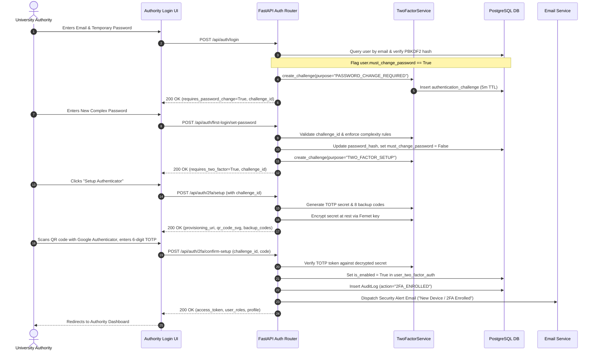
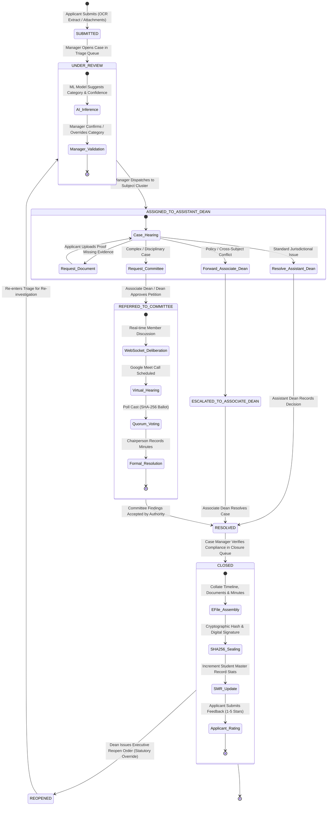
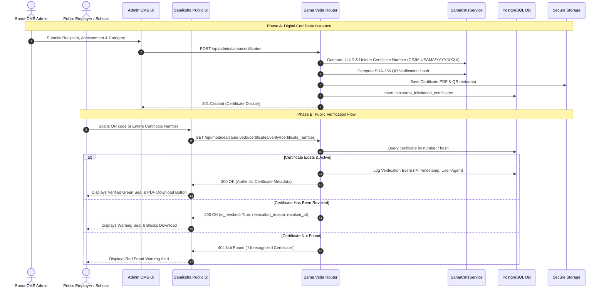
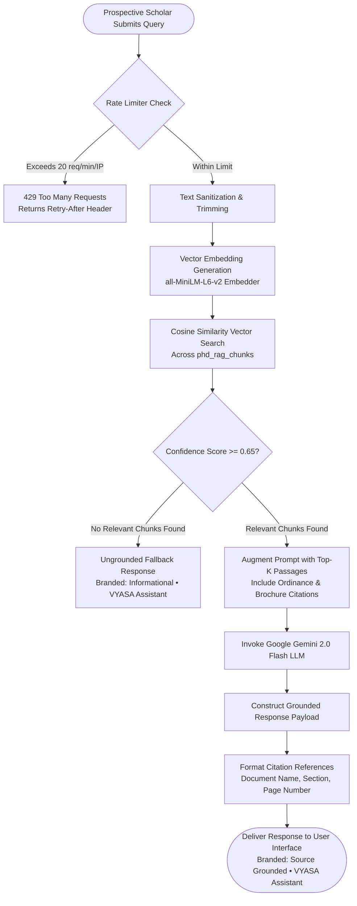

# VYASA-N — SYSTEM-WIDE OPERATIONAL WORKFLOWS

**Audit Date:** November 7, 2026  
**Auditor Classification:** Principal Software Architect & Process Modeler  

---

## 1. Overview of Master Workflows

This document models the end-to-end user and operational workflows implemented within the VYASA-N ecosystem. Each workflow maps the initiating actor, permission requirements, input payloads, validation rules, API interactions, database mutations, notification dispatches, and exception branches.

---

## 2. Workflow 1: Authority First-Login Onboarding & TOTP 2FA Enforcement

All institutional authorities (Case Managers, Assistant Deans, Associate Deans, Deans, Super Admins) must complete mandatory cryptographic onboarding before accessing the platform.



---

## 3. Workflow 2: End-to-End Grievance Redressal Lifecycle (NIVARAN-AI)

This workflow represents the core operational pipeline of Atharva Veda, tracking a student complaint from intake to cryptographic sealing.



### Operational Steps in the Lifecycle:
1. **Intake & Quota Check:**
   - Validates student has < 3 active grievances.
   - Computes text similarity against existing cases to prevent spam/duplicate filings.
   - Extracts OCR text from PDF/image affidavits via Gemini OCR.
2. **AI-Assisted Triage:**
   - Case Manager inspects ML classification (`category_classifier.joblib`).
   - If accepted, system matches approved category Turn-Around-Time (TAT) and auto-routes to the Assistant Dean managing the subject cluster.
3. **Investigation & Evidentiary Request:**
   - Assistant Dean reviews dossier.
   - Can issue a `RequestDocumentModal` prompt; case transitions to `AWAITING_DOCUMENT`, pausing the resolution TAT timer.
4. **Resolution Recording:**
   - Authority inputs formal resolution remarks. System dispatches branded notifications via email and web portal.
5. **Manager Verification & E-File Sealing:**
   - Manager reviews compliance.
   - System invokes `efile_pdf_generator.py`, compiling all filings, approvals, timestamps, and signatures into a standardized PDF.
   - Dossier is hashed with SHA-256 and stored with immutable metadata.

---

## 4. Workflow 3: Statutory Committee Formation, Hearing & Consensus Voting

```mermaid
flowchart TD
    START([Case Requires Inquiry Tribunal]) --> REQ{Authority Level}
    
    REQ -->|Assistant Dean| PETITION[Submit Committee Creation Petition<br/>POST /committees/requests/{id}]
    REQ -->|Associate Dean / Dean| CHARTER[Direct Committee Chartering<br/>POST /committees/direct]

    PETITION --> REVIEW[Associate Dean / Dean Reviews Request]
    REVIEW -->|Clarification Requested| REVISE[Assistant Dean Refines Terms of Reference]
    REVISE --> REVIEW
    REVIEW -->|Rejected| DENIED[Petition Dismissed with Remarks]
    REVIEW -->|Approved| CHARTER

    CHARTER --> SETUP[Assign Chairperson, Members & Observers<br/>Unique Constraint Enforced]
    
    SETUP --> WORKSPACE[Active Committee Workspace Initialized]
    
    subgraph DEDICATED_WORKSPACE ["Committee Workspace Operations"]
        WORKSPACE --> CHAT[Real-Time Evidentiary Deliberation<br/>WebSocket / Fallback REST]
        WORKSPACE --> MEET[Schedule Virtual Hearing<br/>Google Calendar / Meet Integration]
        WORKSPACE --> DOCS[Upload Confidential In-Camera Evidence]
        WORKSPACE --> POLL[Launch Formal Resolution Poll]
        
        POLL --> VOTE[Members Cast Cryptographic Ballots<br/>SHA-256 Ballot Hashing]
        VOTE --> TALLY{Quorum & Policy Met?}
        TALLY -->|Simple Majority / 2/3 / Unanimous| ADOPT[Resolution Passed]
        TALLY -->|Quorum Failed| RETRY[Re-convene or Extend Poll]
    end

    ADOPT --> MINUTES[Chairperson Submits Formal Minutes & Findings<br/>POST /committees/{id}/decisions]
    MINUTES --> DISSOLVE[Committee Formally Dissolved<br/>Findings Attached to Grievance Dossier]
    DISSOLVE --> RESOLVE_CASE[Case Marked as RESOLVED]
```

---

## 5. Workflow 4: Sama Veda Research Recognition & Certificate Verification



---

## 6. Workflow 5: Public Ph.D. RAG Conversational Guidance


