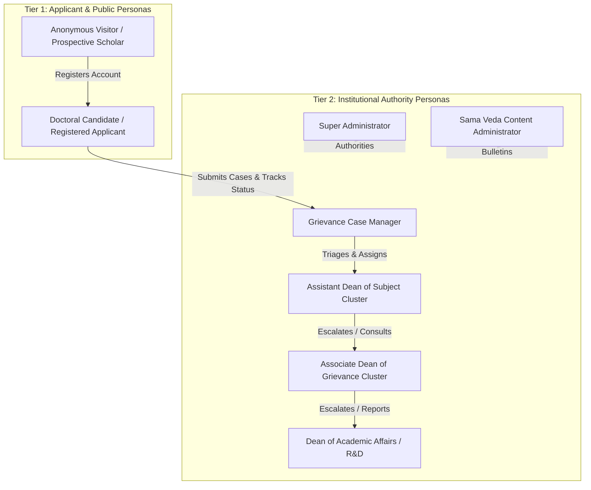

# VYASA-N — USER ROLES, PERSONAS & PERMISSION ARCHITECTURE

**Audit Date:** November 7, 2026  
**Auditor Classification:** Security Reviewer & Enterprise Architect  
**Subject Platform:** VYASA-N Core Identity & Authority Subsystem  

---

## 1. Identity & Persona Taxonomy

VYASA-N enforces an institutional role-based access control (RBAC) model rooted in the university's governance statutes. The platform cleanly partitions users into two distinct operational tiers:

---

## 2. Granular Role Specifications

### 1. Anonymous Public Visitor
- **Persona Context:** Prospective doctoral candidates, general public, employers, external scholars.
- **Accessible Interfaces:**
  - Landing Page (`/`) with Vedic domain overviews.
  - Sama Veda / ANVESHAN Research Portal (`/modules/sama-veda`), including public bulletin downloads, researcher spotlights, and publication catalog.
  - Public Certificate QR Verification Portal (`/modules/sama-veda/felicitation`).
  - Public Ph.D. Admission Grounded RAG Assistant (`/phd-assistant`, `/public/phd-admission/*`).
- **Security Invariant:** No JWT token required; strictly read-only or rate-limited conversational endpoints.

### 2. Applicant (`applicant` / `DOCTORAL_SCHOLAR`)
- **Persona Context:** Enrolled university students, doctoral researchers, and applicants seeking grievance resolution.
- **Authentication:** Standard email and password login (`/applicant/login`). Single-factor authentication.
- **Accessible Interfaces:**
  - Applicant Workspace & Dashboard (`/applicant/dashboard`, `/applicant/my-grievances`).
  - Grievance Submission Wizard (`/modules/atharva-veda/nivaran/submit`).
  - Case Detail & Timeline Tracking (`/modules/atharva-veda/nivaran/grievance/:id`).
  - Personal Student Master Record (`/modules/atharva-veda/nivaran/student-records/me`).
  - Sealed E-Files Archive (`/modules/atharva-veda/nivaran/e-files`).
- **Permissions & Scoping:**
  - `applicant:create_grievance`
  - `applicant:read_own_grievance`
  - `applicant:upload_document`
  - `applicant:submit_feedback`
- **Security Invariants:**
  - Strictly blocked from accessing any administrative or authority queue.
  - Can only query grievances where `applicant_user_id == current_user.id` (enforced at database query level).
  - Maximum limit of 3 concurrent active grievances.

### 3. Case Manager (`manager` / `GRIEVANCE_MANAGER`)
- **Persona Context:** Central administrative triage officer responsible for intake verification and post-resolution closure.
- **Authentication:** Authority Login (`/login`) with mandatory First-Login Password Change and TOTP 2FA.
- **Accessible Interfaces:**
  - Manager Intake Triage Queue (`/modules/atharva-veda/nivaran/manager/queue`).
  - AI Review & Classification Verification (`/modules/atharva-veda/nivaran/manager/review/:id`).
  - Manager Final Closure Queue (`/modules/atharva-veda/nivaran/manager/closure-queue`).
- **Permissions & Scoping:**
  - `nivaran:triage_grievances`
  - `nivaran:override_ai_classification`
  - `nivaran:dispatch_to_assistant_dean`
  - `nivaran:finalize_case_closure`
- **Security Invariants:**
  - Cannot resolve a case on merits (resolution is an academic authority prerogative).
  - Can reclassify category and adjust priority during intake review.

### 4. Assistant Dean (`assistant_dean`)
- **Persona Context:** Faculty officers appointed to oversee specific subject clusters (e.g., Physical Sciences, Humanities, Engineering).
- **Authentication:** Authority Login with mandatory TOTP 2FA.
- **Accessible Interfaces:**
  - Assistant Dean Case Dashboard (`/modules/atharva-veda/nivaran/assistant-dean/dashboard`).
  - Dedicated Case Review & Hearing Interface (`/modules/atharva-veda/nivaran/assistant-dean/grievance/:id`).
- **Permissions & Scoping:**
  - `nivaran:resolve_case` (for assigned subject cluster cases)
  - `nivaran:request_document` (issues formal evidence request to applicant)
  - `nivaran:forward_case` (forwards case to Associate Dean or Dean)
  - `nivaran:request_committee` (submits petition to form inquiry committee)
- **Security Invariants:**
  - Strictly forbidden from resolving cases outside their assigned subject cluster.
  - Cannot charter committees directly; must petition Associate Dean or Dean.

### 5. Associate Dean (`associate_dean`)
- **Persona Context:** Senior administrative officers overseeing functional grievance clusters (e.g., Academic Affairs, Examinations, Finance).
- **Authentication:** Authority Login with mandatory TOTP 2FA.
- **Accessible Interfaces:**
  - Associate Dean Executive Dashboard (`/modules/atharva-veda/nivaran/associate-dean/dashboard`).
  - Cluster Cases Ledger (`/modules/atharva-veda/nivaran/associate-dean/cases`).
  - Case Review & Escalation Suite (`/modules/atharva-veda/nivaran/associate-dean/grievance/:id`).
- **Permissions & Scoping:**
  - `nivaran:resolve_case` (cluster-level cases)
  - `nivaran:escalate_to_dean` (formal escalation to the Dean)
  - `nivaran:charter_committee` (direct chartering of departmental committees)
  - `nivaran:review_committee_request` (approves/rejects Assistant Dean petitions)
- **Security Invariants:**
  - Can charter committees directly for cases within their jurisdiction.
  - Can petition the Dean for inter-faculty apex committees.

### 6. Dean of Academic Affairs / R&D (`dean`)
- **Persona Context:** The apex executive authority for academic and research operations at CSJMU.
- **Authentication:** Authority Login with mandatory TOTP 2FA.
- **Accessible Interfaces:**
  - Dean Executive Command Center (`/modules/atharva-veda/nivaran/dean/dashboard`).
  - Institution-wide Case Ledger (`/modules/atharva-veda/nivaran/dean/cases`).
  - High-Level Case Review & Direct Intervention Suite.
- **Permissions & Scoping:**
  - `nivaran:executive_overview` (unrestricted view across all subjects and clusters)
  - `nivaran:charter_committee` (charters apex university inquiry tribunals)
  - `nivaran:reopen_closed_case` (sole authority permitted to order case reopening)
  - `nivaran:direct_resolution` (overrides lower-tier resolutions if necessary)
- **Security Invariants:**
  - Has university-wide read and resolution authority.
  - Requests for higher-tier committee approval are blocked because the Dean is the final statutory appellate tier.

### 7. Super Administrator (`super_admin` / `administrator`)
- **Persona Context:** University technical operations lead and registrar's technical delegate.
- **Authentication:** CLI-provisioned credentials via `setup_super_admin.py` with mandatory TOTP 2FA.
- **Accessible Interfaces:**
  - Institutional Administration Console (`/admin`).
  - Taxonomy & Subject Management (`/admin/atharva/subjects`, `/subject-clusters`).
  - Grievance Category & TAT Configuration (`/admin/atharva/categories`).
  - Institutional Authority Roster & Office Transfer (`/admin/atharva/authorities`).
  - Platform-Wide Audit Log Explorer (`/admin/audit-logs`).
- **Permissions & Scoping:**
  - Complete control over system master data, taxonomy, routing tables, and roles.
  - Strictly separated from handling active individual student grievance deliberations to preserve academic neutrality.

### 8. Sama Veda Content Administrator (`sama_content_admin` / `sama_content_editor`)
- **Persona Context:** University research office staff, bulletin editors, and felicitation officers.
- **Authentication:** Authority Login with TOTP 2FA.
- **Accessible Interfaces:**
  - Sama Veda Administrative CMS (`/admin/sama`).
  - Publication Editor (`/admin/sama/publications`).
  - Bulletin Publisher (`/admin/sama/bulletins`).
  - Digital Certificate Issuer (`/admin/sama/certificates`).
  - Bulk Research Data Importer (`/admin/sama/import`).
- **Permissions & Scoping:**
  - `sama:manage_publications`
  - `sama:publish_bulletin`
  - `sama:issue_certificate`
  - `sama:import_data`

---

## 3. Comprehensive Permission Matrix

| Granular Permission Code | Applicant | Case Manager | Assistant Dean | Associate Dean | Dean | Super Admin | Sama CMS Admin |
| :--- | :---: | :---: | :---: | :---: | :---: | :---: | :---: |
| `applicant:profile:read` | &check; | &cross; | &cross; | &cross; | &cross; | &cross; | &cross; |
| `grievance:submit` | &check; | &cross; | &cross; | &cross; | &cross; | &cross; | &cross; |
| `grievance:track_own` | &check; | &cross; | &cross; | &cross; | &cross; | &cross; | &cross; |
| `grievance:triage_intake` | &cross; | &check; | &cross; | &cross; | &cross; | &cross; | &cross; |
| `grievance:resolve:subject` | &cross; | &cross; | &check; | &cross; | &cross; | &cross; | &cross; |
| `grievance:resolve:cluster` | &cross; | &cross; | &cross; | &check; | &cross; | &cross; | &cross; |
| `grievance:resolve:apex` | &cross; | &cross; | &cross; | &cross; | &check; | &cross; | &cross; |
| `committee:request` | &cross; | &cross; | &check; | &check; | &cross; | &cross; | &cross; |
| `committee:charter_direct` | &cross; | &cross; | &cross; | &check; | &check; | &cross; | &cross; |
| `committee:vote_deliberate`| &cross; | &cross; | &check; (if appointed) | &check; (if appointed) | &check; (if appointed) | &cross; | &cross; |
| `case:finalize_closure` | &cross; | &check; | &cross; | &cross; | &cross; | &cross; | &cross; |
| `case:reopen` | &cross; | &cross; | &cross; | &cross; | &check; | &cross; | &cross; |
| `efile:verify_seal` | &check; | &check; | &check; | &check; | &check; | &check; | &cross; |
| `admin:manage_taxonomy` | &cross; | &cross; | &cross; | &cross; | &cross; | &check; | &cross; |
| `admin:transfer_authority`| &cross; | &cross; | &cross; | &cross; | &cross; | &check; | &cross; |
| `admin:view_audit_logs` | &cross; | &cross; | &cross; | &cross; | &cross; | &check; | &cross; |
| `sama:manage_cms` | &cross; | &cross; | &cross; | &cross; | &cross; | &check; | &check; |
| `sama:revoke_certificate`| &cross; | &cross; | &cross; | &cross; | &cross; | &check; | &check; |
