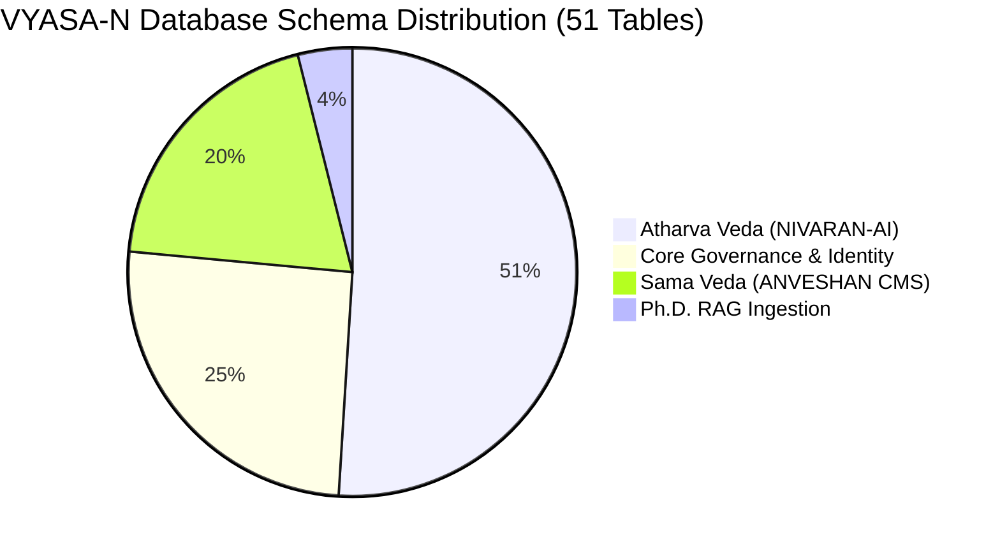

# VYASA-N — DATABASE ARCHITECTURE SPECIFICATION

**Audit Date:** November 7, 2026  
**Auditor Classification:** Database Architect & Performance Specialist  
**Database Engine:** PostgreSQL 16+ (Neon Serverless PostgreSQL)  
**ORM / Data Access:** SQLAlchemy 2.0 with Psycopg 3  

---

## 1. Relational Database Overview & Topology

VYASA-N is deployed on a **single unified PostgreSQL database** ([`ADR-002`](file:///c:/Projects/VYASA/docs/decisions/ADR-002-single-postgresql-database.md)). The relational schema encompasses **51 distinct database tables** created and evolved across **19 linear Alembic migrations**.

---

## 2. Complete Database Table Inventory

### A. Core Governance, Identity & System Tables (13 Tables)

| Table Name | Primary Purpose | Primary Key | Key Foreign Keys & Constraints |
| :--- | :--- | :--- | :--- |
| `users` | Central identity ledger for all system users | `id` (UUID) | Unique `email`. Indexes on `email`, `is_active`. |
| `roles` | Institutional and system governance roles | `id` (UUID) | Unique `name`. Seeds: `super_admin`, `applicant`, `manager`, etc. |
| `permissions` | Granular capability authorizations | `id` (UUID) | Unique `name`. Categorized by `module`. |
| `user_roles` | Association join table mapping users to roles | Composite | FK `user_id` &rarr; `users.id`, FK `role_id` &rarr; `roles.id`. |
| `role_permissions` | Association join table mapping roles to permissions | Composite | FK `role_id` &rarr; `roles.id`, FK `permission_id` &rarr; `permissions.id`. |
| `applicant_profiles` | Academic identity snapshot for doctoral candidates | `id` (UUID) | FK `user_id` &rarr; `users.id` (1:1). Unique `enrollment_number`. |
| `audit_logs` | Immutable audit trail of state mutations | `id` (UUID) | FK `user_id` &rarr; `users.id` (nullable for system events). |
| `notifications` | Central notification messages across all pillars | `id` (UUID) | FK `user_id` &rarr; `users.id`. Index on `(user_id, is_read)`. |
| `notification_preferences` | User channel opt-out preferences | `id` (UUID) | FK `user_id` &rarr; `users.id` (1:1). |
| `user_two_factor_auth` | Encrypted TOTP secret seeds and backup codes | `id` (UUID) | FK `user_id` &rarr; `users.id` (1:1). Fernet-encrypted secret. |
| `authentication_challenges`| Pre-auth state challenges (2FA, Password Reset)| `id` (UUID) | FK `user_id` &rarr; `users.id`. Indexes on `expires_at`, `is_used`. |
| `modules` | System registry of Veda governance modules | `id` (UUID) | Unique `key` (`rig_veda`, `yajur_veda`, `sama_veda`, `atharva_veda`). |
| `pillars` | Presentation metadata for ecosystem pillars | `id` (UUID) | Unique `slug`. Maps route paths and icons. |

---

### B. Atharva Veda &bull; NIVARAN-AI Subsystem Tables (26 Tables)

| Table Name | Primary Purpose | Primary Key | Key Foreign Keys & Constraints |
| :--- | :--- | :--- | :--- |
| `nivaran_subject_clusters` | Groups academic disciplines under Assistant Deans | `id` (UUID) | FK `assistant_dean_id` &rarr; `nivaran_authorities.id`. |
| `nivaran_subjects` | 56 official university academic subjects | `id` (UUID) | FK `cluster_id` &rarr; `nivaran_subject_clusters.id`. Unique `name`. |
| `nivaran_authorities` | Official appointments for university officials | `id` (UUID) | FK `user_id` &rarr; `users.id` (1:1). Role enum check. |
| `nivaran_grievance_clusters`| Functional grievance categories (Academic, etc.) | `id` (UUID) | FK `associate_dean_id` &rarr; `nivaran_authorities.id`. |
| `nivaran_grievance_categories`| Approved complaints categories with standard TAT | `id` (UUID) | FK `grievance_cluster_id` &rarr; `nivaran_grievance_clusters.id`. |
| `nivaran_grievances` | Master grievance case docket | `id` (UUID) | Unique `tracking_id`. FKs to `applicant`, `subject`, `category`. |
| `nivaran_grievance_documents`| Uploaded affidavits, petitions, and evidence | `id` (UUID) | FK `grievance_id` &rarr; `nivaran_grievances.id`. SHA-256 `file_hash`. |
| `nivaran_document_requests`| Formal requests for additional applicant evidence | `id` (UUID) | FK `grievance_id` &rarr; `nivaran_grievances.id`. |
| `nivaran_case_history` | Chronological transition ledger | `id` (UUID) | FK `grievance_id` &rarr; `nivaran_grievances.id`. Records actor & IP. |
| `nivaran_grievance_approvals`| Multi-tier sign-off decisions | `id` (UUID) | FK `grievance_id` &rarr; `nivaran_grievances.id`. Stage enum. |
| `nivaran_committee_creation_requests` | Formal petitions to form statutory panels | `id` (UUID) | FK `grievance_id` &rarr; `nivaran_grievances.id`. Member snapshot JSONB. |
| `nivaran_committees` | Chartered inquiry tribunals and panels | `id` (UUID) | FK `chairperson_id` &rarr; `nivaran_authorities.id`. Status enum. |
| `nivaran_committee_members` | Roster of appointed committee officials | `id` (UUID) | Unique `(committee_id, authority_id)`. Role enum. |
| `nivaran_committee_messages`| In-camera committee deliberation chat records | `id` (UUID) | FK `committee_id` &rarr; `nivaran_committees.id`. Chronological index. |
| `nivaran_committee_polls` | Formal consensus voting ballots | `id` (UUID) | Voting policy enum (`SIMPLE_MAJORITY`, `TWO_THIRDS`, `UNANIMOUS`). |
| `nivaran_committee_poll_options` | Voting choices for a poll | `id` (UUID) | Unique `(poll_id, option_key)`. |
| `nivaran_committee_poll_voters` | Roster of eligible voters and completion flags | `id` (UUID) | Unique `(poll_id, member_id)`. Prevents duplicate voting. |
| `nivaran_committee_poll_votes` | Cryptographically hashed cast ballots | `id` (UUID) | Unique `(poll_id, voter_member_id)`. SHA-256 `vote_hash`. |
| `nivaran_committee_meetings`| Scheduled hearings and Google Meet conferences | `id` (UUID) | FK `committee_id` &rarr; `nivaran_committees.id`. Google Event ID. |
| `nivaran_committee_decisions`| Formal findings and minutes of inquiry panels | `id` (UUID) | FK `committee_id` &rarr; `nivaran_committees.id`. Formal resolution text. |
| `nivaran_efiles` | Cryptographically sealed case dossiers (PDFs) | `id` (UUID) | Unique `efile_number`. Immutable SHA-256 `dossier_hash`. |
| `nivaran_student_master_records` | Unified longitudinal student record | `id` (UUID) | Unique `roll_number`, `enrollment_number`. Complaint counts. |
| `nivaran_grievance_feedbacks` | Applicant satisfaction reviews (1-5 stars) | `id` (UUID) | FK `grievance_id` &rarr; `nivaran_grievances.id` (1:1). Rating check. |
| `nivaran_ai_classification_logs` | Machine learning prediction audit log | `id` (UUID) | FK `grievance_id` &rarr; `nivaran_grievances.id`. Confidence score float. |
| `nivaran_dean_reopen_requests` | Formal petition and order to reopen closed cases | `id` (UUID) | FK `grievance_id` &rarr; `nivaran_grievances.id`. Dean authority check. |
| `nivaran_digital_signatures` | Cryptographic sign-offs on official resolutions | `id` (UUID) | Hashed signature block with public algorithm verification. |

---

### C. Sama Veda &bull; ANVESHAN / SAMIKSHA Tables (10 Tables)

| Table Name | Primary Purpose | Primary Key | Key Foreign Keys & Constraints |
| :--- | :--- | :--- | :--- |
| `sama_bulletins` | Published university research bulletins | `id` (UUID) | Unique `(volume, issue)`. PDF storage key. |
| `sama_research_publications` | Peer-reviewed research papers and articles | `id` (UUID) | Unique `slug`. Unique `doi` (nullable). FK to `bulletin`. |
| `sama_research_authors` | Faculty and scholar author registry | `id` (UUID) | Unique `scopus_id`, `orcid_id`. Department indexing. |
| `sama_publication_authors` | Multi-author association table with order | Composite | FK `publication_id`, FK `author_id`. `author_order` int. |
| `sama_cam_projects` | Centre for Advanced Materials funded projects | `id` (UUID) | Grant amount in INR, PI name, sanction year. |
| `sama_felicitation_certificates`| Official merit and recognition certificates | `id` (UUID) | Unique `certificate_number`. SHA-256 `qr_hash`. Revocation flag. |
| `sama_certificate_verification_events`| Telemetry of QR code scans | `id` (UUID) | FK `certificate_id` &rarr; `sama_felicitation_certificates.id`. IP & UA. |
| `sama_fellowship_schemes` | University and national research fellowships | `id` (UUID) | Unique `scheme_name`. Eligibility criteria text. |
| `sama_researcher_spotlights` | Featured faculty breakthroughs on homepage | `id` (UUID) | Display order integer, active flag. |
| `sama_import_batches` | Audit trail of bulk Excel/CSV publication imports| `id` (UUID) | Total vs. successful records count, JSON error log. |

---

### D. Public Ph.D. RAG Tables (2 Tables)

| Table Name | Primary Purpose | Primary Key | Key Foreign Keys & Constraints |
| :--- | :--- | :--- | :--- |
| `phd_rag_documents` | Official university brochures and ordinances | `id` (UUID) | Unique `filename`. SHA-256 document checksum. |
| `phd_rag_chunks` | Parsed passages with vector embeddings | `id` (UUID) | FK `document_id` &rarr; `phd_rag_documents.id`. Vector column. |

---

## 3. Migration History & Evolution (19 Alembic Versions)

The database schema has evolved linearly without branching or version collisions:
1. `e09046751800`: Initial foundational schema (`users`, `roles`, `permissions`, `modules`).
2. `74bfd3bf7936`: Added `applicant_profiles` with academic fields.
3. `8b29c54e1001`: Core evolution (`audit_logs`, `pillars`).
4. `8b29c54e1002`: Atharva taxonomy & authorities (`nivaran_subjects`, `nivaran_authorities`).
5. `8b29c54e1003`: Atharva case core (`nivaran_grievances`, `case_history`).
6. `8b29c54e1004`: Atharva documents & committees (`nivaran_committees`, `committee_members`).
7. `8b29c54e1005`: Atharva signatures, e-files, approvals & AI (`nivaran_efiles`, `digital_signatures`).
8. `8b29c54e1006`: Ph.D. RAG documents and chunks.
9. `8b29c54e1007`: Unified Notification Centre (`notifications`, `notification_preferences`).
10. `8b29c54e1008`: Notification source branding backfill.
11. `8b29c54e1009`: Committee workflow permissions (clarification status, terms of reference).
12. `8b29c54e1010`: Committee management workspace (dissolution reason, formal decisions).
13. `8b29c54e1011`: Committee chat message chronological indexing.
14. `8b29c54e1012`: Provisioning of canonical `super_admin` role.
15. `8b29c54e1013`: Authority two-factor authentication (`user_two_factor_auth`).
16. `8b29c54e1014`: Sama Veda core schema (`bulletins`, `publications`, `authors`).
17. `8b29c54e1015`: Sama Veda CMS lifecycle (`cam_projects`, `certificates`, `spotlights`).
18. `8b29c54e1016`: Sama Veda bulk import batches (`sama_import_batches`).
19. `8b29c54e1017`: Added `must_change_password` flag to `users`.
