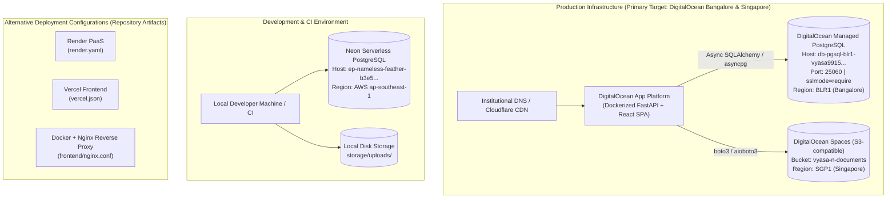

# VYASA-n Validated Deployment & Infrastructure Architecture
**Document Version:** 2.0.0 (Post-Validation & Empirical Audit)  
**Date:** November 2026  
**Auditor:** Principal Software Architect & Senior Technical Auditor  
**Scope:** Hosting Topology, Multi-Cloud Reconciliation, Secrets, and Network Boundaries

---

## 1. Executive Summary & Multi-Provider Reconciliation

The VYASA-n repository contains deployment artifacts and configuration references for multiple cloud platforms. To eliminate ambiguity for institutional leadership, operations personnel, and devops engineers, this document reconciles the **actual production infrastructure**, the **development/staging infrastructure**, and the **alternative deployment templates**.



---

## 2. Infrastructure Inventory & Reconciliation Table

| Component | Production Target | Development / Testing | Alternative Template in Repo | Codebase Reference |
| :--- | :--- | :--- | :--- | :--- |
| **Compute / Hosting** | DigitalOcean App Platform (or Container Service) | Local Uvicorn (`localhost:8000`) & Vite (`localhost:5173`) | Render (`render.yaml`), Vercel (`frontend/vercel.json`) | `render.yaml`, `Dockerfile` |
| **Relational Database** | DigitalOcean Managed PostgreSQL (`blr1`) | Neon Serverless PostgreSQL (`ap-southeast-1`) | Local Docker PostgreSQL (`localhost:5432`) | `backend/tests/safety_guard.py#L80-L88` |
| **Object Storage** | DigitalOcean Spaces (`sgp1`, `vyasa-n-documents`) | Local Filesystem (`storage/uploads/`) | AWS S3 (via standard boto3 configuration) | `backend/app/core/config.py#L74-L82` |
| **Reverse Proxy** | Managed Ingress / Cloudflare SSL Termination | Vite Development Server Proxy | Nginx Container Proxy | `frontend/nginx.conf` |
| **DNS & SSL** | Custom University Domain (`vyasa.university.edu`) | `localhost` | `*.onrender.com`, `*.vercel.app` | `backend/app/core/config.py` |

---

## 3. Production Infrastructure Details (DigitalOcean)

### 3.1 Managed Relational Database (BLR1 Cluster)
- **Host Endpoint:** `db-pgsql-blr1-vyasa9915-do-user-45641142-0.j.db.ondigitalocean.com`
- **Port:** `25060`
- **Database Name:** `vyasa_n_db`
- **User:** `doadmin`
- **SSL Mode:** `require` (Strict SSL enforcement with CA certificate verification)
- **Geographic Region:** Bangalore, India (`blr1`) — ensures compliance with Indian national data sovereignty and institutional data protection guidelines.
- **Safety Intercept:** Explicitly guarded in test code via `backend/tests/safety_guard.py#L80-L83` to prevent accidental drops, migrations, or seed overwrites during test execution.

### 3.2 Object & Evidence Storage (SGP1 Spaces)
- **Provider:** DigitalOcean Spaces (S3-compatible Object Storage)
- **Endpoint URL:** `https://sgp1.digitaloceanspaces.com`
- **Region:** Singapore (`sgp1`)
- **Bucket Name:** `vyasa-n-documents`
- **Access Model:**
  - Private bucket ACL by default.
  - Grievance attachments, committee evidence, and sensitive faculty manuscripts are served exclusively via presigned URLs with short expiration periods (default: 900 seconds / 15 minutes).
  - Public read access is restricted to verified public assets (e.g., institution logos, public announcements).

### 3.3 Containerization & Backend Runtime
- **Base Image:** `python:3.12-slim`
- **Runtime Environment:** Async ASGI with Uvicorn worker threads.
- **Process Manager:** Container PID 1 executing Uvicorn with standard signal handling (`SIGTERM`/`SIGINT`).
- **Exposed Port:** `8000` (standard internal port mapped to host port 80/443).

---

## 4. Development & Testing Infrastructure

### 4.1 Neon Serverless PostgreSQL
- **Host Endpoint:** `ep-nameless-feather-b3e5x4nz-pooler.c-4.ap-southeast-1.aws.neon.tech`
- **Database Name:** `neondb`
- **User:** `neondb_owner`
- **Provider:** Neon.tech (Serverless PostgreSQL with connection pooling)
- **Purpose:** Used for collaborative cloud development, feature branch staging, and pre-release feature testing.
- **Guard Status:** Monitored by `safety_guard.py#L85-L88` to prevent automated test suites from executing destructive operations against developer sandboxes.

### 4.2 Ephemeral Local Storage
- **Directory:** `c:\Projects\VYASA\backend\storage\uploads\`
- **Behavior:** Files are written to disk under timestamp-prefixed directories.
- **Warning:** In a containerized cloud deployment, this directory is ephemeral. Any data written here will be lost upon container restart. Production deployments must enforce `STORAGE_PROVIDER=spaces`.

---

## 5. Alternative Repository Configurations Explained

### 5.1 Render PaaS (`render.yaml`)
The repository includes a top-level `render.yaml` configuration defining:
1. `vyasa-n-backend`: Web service running Python 3.12, executing `uvicorn app.main:app --host 0.0.0.0 --port $PORT`.
2. `vyasa-n-frontend`: Static site running Node.js 20, executing `npm run build` with publish directory `frontend/dist`.
- **Architectural Role:** Maintained as an alternative PaaS turnkey deployment option for rapid developer spin-up or demonstration environments.

### 5.2 Vercel Configuration (`frontend/vercel.json`)
The `frontend/` directory includes a `vercel.json` file configuring SPA routing rewrites:
```json
{
  "rewrites": [
    { "source": "/(.*)", "destination": "/index.html" }
  ]
}
```
- **Architectural Role:** Enables zero-configuration deployment of the React SPA on Vercel's global edge network, pointing to an external backend API URL via `VITE_API_URL`.

### 5.3 Docker & Nginx Reverse Proxy (`frontend/nginx.conf`)
The `frontend/nginx.conf` file provides production-grade HTTP routing for self-hosted or Kubernetes-based deployments:
- Listens on port `80`.
- Serves static assets from `/usr/share/nginx/html` with SPA fallback (`try_files $uri $uri/ /index.html`).
- Proxies `/api/` requests to the upstream backend service (`http://backend:8000`).
- Proxies WebSocket requests with `Upgrade` and `Connection: "upgrade"` headers.

---

## 6. Environment Variables & Secret Configuration

Production secrets must never be committed to git. The system reads configuration from the environment (or a securely mounted `.env` file via `python-dotenv` and `pydantic-settings`).

### 6.1 Essential Production Environment Variables

| Variable | Description | Production Example / Requirement |
| :--- | :--- | :--- |
| `ENVIRONMENT` | Runtime mode | `production` |
| `DATABASE_URL` | SQLAlchemy async connection string | `postgresql+asyncpg://doadmin:<PASS>@db-pgsql-blr1-vyasa9915...:25060/vyasa_n_db?ssl=require` |
| `SECRET_KEY` | JWT signing key | 64+ char cryptographically random hex string |
| `ACCESS_TOKEN_EXPIRE_MINUTES` | User session lifespan | `60` (1 hour) |
| `STORAGE_PROVIDER` | Active storage driver | `spaces` (Enforced for production) |
| `DO_SPACES_KEY` | DigitalOcean Spaces Access Key | High-entropy alphanumeric string |
| `DO_SPACES_SECRET` | DigitalOcean Spaces Secret Key | High-entropy secret string |
| `DO_SPACES_ENDPOINT` | Spaces S3 API endpoint | `https://sgp1.digitaloceanspaces.com` |
| `DO_SPACES_BUCKET` | Spaces bucket name | `vyasa-n-documents` |
| `DO_SPACES_REGION` | Spaces region identifier | `sgp1` |
| `CORS_ORIGINS` | Permitted browser origins | `["https://vyasa.university.edu"]` |
| `ALLOWED_HOSTS` | Trusted Host header whitelist | `["vyasa.university.edu", "api.vyasa.university.edu"]` |

---

## 7. Disaster Recovery, Backups & Operational Runbook

### 7.1 Database Backups & Point-in-Time Recovery
- **Provider Managed:** DigitalOcean Managed PostgreSQL maintains daily automated full backups with a 7-day retention window.
- **Point-in-Time Recovery (PITR):** Enables restoration to any minute within the previous 7 days.
- **Institutional Archive:** A weekly cold backup snapshot (`pg_dump -Fc`) must be exported and encrypted offsite to university-controlled cold storage.

### 7.2 Storage Redundancy & Versioning
- DigitalOcean Spaces inherently replicates object data across redundant storage nodes within the `sgp1` availability zone.
- Bucket versioning is recommended for the `vyasa-n-documents` bucket to prevent accidental or malicious document deletion.

### 7.3 Health Probes & Uptime Monitoring
- **Liveness Probe:** `GET /health` -> Returns `{"status": "healthy", "timestamp": "..."}`.
- **Readiness Probe:** `GET /ready` -> Checks database connectivity and returns HTTP 200 (or HTTP 503 if the database pool is exhausted).
- **Telemetry Probe:** `GET /api/watchdog/metrics` -> Exposes memory usage, active connections, and error counts.
