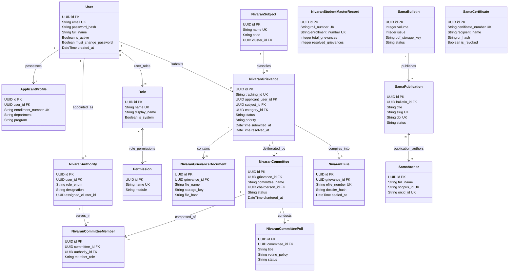

# VYASA-N — ENTITY RELATIONSHIP DIAGRAM (ERD)

**Audit Date:** November 7, 2026  
**Auditor Classification:** Database Architect & Data Modeler  
**Format:** Mermaid Class Diagram (`classDiagram`)  

---

## 1. High-Level Relational Diagram

---

## 2. Key Relationship Constraints & Invariants

1. **User to Authority Isolation:** A user identity can only link to one `NivaranAuthority` appointment (`user_id` unique constraint), preventing dual-role conflicts within the grievance committee hierarchy.
2. **Grievance Cascading & Deletion Prevention:** While test fixtures use cascading deletes, production database rules enforce `ON DELETE RESTRICT` on grievances with associated legal documents or sealed e-Files.
3. **Committee Membership Uniqueness:** `UNIQUE (committee_id, authority_id)` guarantees an appointed official cannot be duplicated on a single panel.
4. **Voter Ballot Secrecy & Deduplication:** `UNIQUE (poll_id, voter_member_id)` in `nivaran_committee_poll_votes` guarantees one ballot per member while storing only the SHA-256 vote hash, preserving integrity without compromising ballot secrecy.
