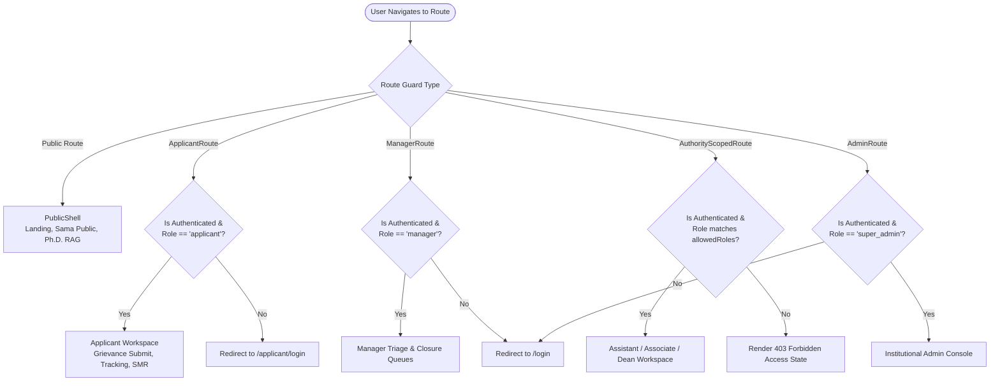

# VYASA-N — FRONTEND ARCHITECTURE SPECIFICATION

**Audit Date:** November 7, 2026  
**Auditor Classification:** Senior Frontend Architect & UI/UX Specialist  
**Target Package:** `@vyasa/frontend` (`frontend/src`)  

---

## 1. Frontend Technology Stack & Dependencies

```json
{
  "framework": "React 19.2.8 (with React DOM 19.2.8)",
  "routing": "React Router DOM 7.18.4",
  "build_tool": "Vite 8.3.0",
  "language": "TypeScript 5.7.3 (Strict Mode)",
  "testing": "Vitest 5.0.2 with @testing-library/react 16.3.3 & jsdom 30.1.1",
  "styling": "Tailwind CSS & CSS Custom Properties Design System (@vyasa/ui)",
  "code_splitting": "Dynamic lazy chunking by Veda module"
}
```

---

## 2. Directory Layout & Organization

The frontend codebase is organized into modular layers enforcing separation of concerns:

```text
frontend/src/
├── admin/                      # Institutional Administration Console
│   ├── components/             # AdminLayout, AdminSidebar, AdminNav, AdminModuleToggleCard
│   ├── pages/
│   │   ├── atharva/            # AuthoritiesPage, SubjectClustersPage, SubjectsPage, CategoriesPage, AuditLogsPage
│   │   └── sama/               # PublicationsPage, AuthorsPage, BulletinsPage, CertificatesPage, ImportPage
│   ├── services/               # adminService, atharvaAdminService, samaAdminService
│   └── types/                  # Admin TypeScript interface contracts
├── assets/                     # Institutional branding imagery (CSJMU logo, Chancellor, VC portraits)
├── components/                 # Shared presentation components
│   ├── auth/                   # Route guards (ApplicantRoute, AdminRoute, ManagerRoute, AuthorityScopedRoute)
│   ├── common/                 # VedicInvocationWrapper, ErrorBoundary, Breadcrumbs
│   └── layout/                 # MainLayout, PublicShell, WorkspaceShell, UnifiedSidebar
├── context/                    # AuthContext (React context provider for user state & tokens)
├── features/                   # Core platform features & cross-cutting interfaces
│   ├── applicant/              # ApplicantDashboardPage, profile dossier, notification widgets
│   ├── auth/                   # ApplicantLoginPage, AuthorityLoginPage, ApplicantRegisterPage
│   ├── dashboard/              # VyasaDashboardPage, AuthorityDashboard, VyasaProfilePage
│   ├── landing/                # Public landing page sections, Vedic domain showcases, hero
│   ├── navigation/             # Ecosystem header, profile dropdown, navigation tabs
│   ├── notifications/          # NotificationBellMenu, NotificationCenterPage
│   └── phd-rag/                # PhdAssistantPage, VoiceInputButton, AudioSpeechPlayer
├── modules/                    # Veda domain governance modules
│   ├── atharva-veda/nivaran/   # NIVARAN-AI: Workspaces, grievance queues, modals, committee suite
│   ├── rig-veda/               # Rig Veda dashboard and placeholder cards
│   ├── sama-veda/              # SAMIKSHA: Public portal, bulletin viewer, publication tabs, analytics
│   └── yajur-veda/             # Yajur Veda dashboard and placeholder cards
├── services/                   # Core API HTTP clients (apiClient, authService, notificationService)
├── styles/                     # Global index.css, typography, color tokens
└── types/                      # Platform-wide TypeScript contracts (auth, navigation, api, wisdom)
```

---

## 3. Declarative Routing & Security Guards

All routing is defined in [`frontend/src/App.tsx`](file:///c:/Projects/VYASA/frontend/src/App.tsx) and managed by React Router DOM 7. Access control is enforced via route-wrapper guards:



### Route Guard Implementations (`src/components/auth/`):
- **`ApplicantRoute`:** Ensures user is authenticated and possesses the `applicant` role. Authorities attempting to enter are redirected.
- **`AuthorityScopedRoute`:** Parameterized by `allowedRoles` (e.g. `['ASSISTANT_DEAN']`, `['ASSOCIATE_DEAN']`, `['DEAN']`). Prevents cross-tier authority intrusion (e.g. Assistant Deans accessing Dean Executive Dashboard).
- **`AdminRoute`:** Restricts access strictly to `super_admin` or `administrator`.
- **`AuthenticatedRoute`:** Requires any valid active session (used for global e-Files and SMR record lookups).

---

## 4. State Management & API Communication

### 1. Authentication & Session Context (`AuthContext.tsx`)
- Maintains JWT `token` in `localStorage` under the canonical key `vyasa_access_token`.
- Parses token claims to extract:
  - User ID and email.
  - Active roles array (`roles: string[]`).
  - Authority appointment details (assigned cluster ID, designation).
  - Profile metadata.
- Exposes session lifecycle methods: `login()`, `logout()`, `refreshUser()`, and persona indicators (`isApplicant`, `isAuthority`, `isAdmin`).

### 2. HTTP API Client (`apiClient.ts`)
- Centralized `fetch` wrapper configured with base URL from `VITE_API_URL` or defaulting to `/api`.
- Automatically injects `Authorization: Bearer <token>` on all outgoing requests.
- Standardizes error parsing, transforming backend `ApiResponse` errors and Starlette 422 validation errors into structured client exceptions.
- Handles automatic session expiration and 401 redirect dispatching.

---

## 5. UI Component Library & Design System (`@vyasa/ui`)

The monorepo contains a dedicated reusable UI library under [`packages/ui/`](file:///c:/Projects/VYASA/packages/ui):
- **Design Tokens:** University maroon (`#800000`), gold accents (`#DAA520`), slate surfaces, and clean typography.
- **Core Components:** `Button`, `Card`, `Badge`, `Modal`, `Input`, `Select`, `Toast`, `EmptyState`, `LoadingState`, `BookLoader`.
- **Institutional Branding Assets:** `UniversityMasthead`, `InstitutionalHeader`, `InstitutionalFooter`, `VyasaBrandHeader`, `CsjmuLogo`.
- **Responsive Layouts:** `PageContainer`, `SectionHeading`, `WorkspaceShell`.
