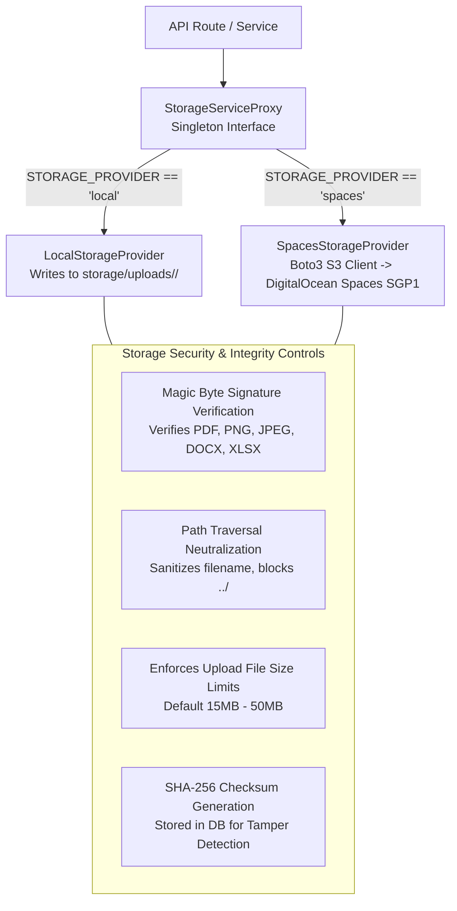

# VYASA-N — STORAGE & DOCUMENT ARCHITECTURE SPECIFICATION

**Audit Date:** November 7, 2026  
**Auditor Classification:** Infrastructure & Cloud Systems Architect  
**Subsystem:** Core Storage Gateway ([`backend/app/core/storage`](file:///c:/Projects/VYASA/backend/app/core/storage))  

---

## 1. Storage Architecture Overview

VYASA-N handles diverse categories of digital assets:
- **Legal Affidavits & Student Petitions:** Uploaded during grievance intake.
- **In-Camera Evidentiary Records:** Submitted during committee hearings.
- **Official Research Bulletins (PDF):** Multi-megabyte university publications.
- **Felicitation Certificates (PDF):** High-resolution awards verified by QR codes.
- **Cryptographically Sealed E-Files:** Immutable case dossiers compiled upon case resolution.

To prevent vendor lock-in while supporting both local offline development and scalable cloud production, the platform implements a **pluggable Storage Provider pattern** managed by `StorageServiceProxy`:

---

## 2. Storage Providers Implementation Detail

### A. Local Storage Provider (`LocalStorageProvider`)
- **Implementation File:** [`backend/app/core/storage/local.py`](file:///c:/Projects/VYASA/backend/app/core/storage/local.py)
- **Base Directory:** `storage/` (configurable via `STORAGE_BASE_DIR`).
- **File Organization:** Files are partitioned into UUID subfolders:
  `storage/uploads/{entity_id}/{short_hash}_{sanitized_filename}`.
- **Path Traversal Protection:** Resolves absolute canonical paths (`Path.resolve()`) and verifies that the destination path starts with the configured base directory root. Throws `StoragePathTraversalError` if a path escapes the sandbox.

### B. Cloud Object Storage Provider (`SpacesStorageProvider`)
- **Implementation File:** [`backend/app/core/storage/spaces.py`](file:///c:/Projects/VYASA/backend/app/core/storage/spaces.py)
- **Target Service:** DigitalOcean Spaces (S3-compatible API, Region: `sgp1` Singapore / Bangalore).
- **Configuration Keys:**
  - `SPACES_BUCKET` (e.g. `vyasa-n-documents`)
  - `SPACES_REGION` (`sgp1`)
  - `SPACES_ENDPOINT_URL` (`https://sgp1.digitaloceanspaces.com`)
  - `SPACES_ACCESS_KEY_ID`
  - `SPACES_SECRET_ACCESS_KEY`
- **Fail-Closed Validation:** In production mode, if `STORAGE_PROVIDER=spaces` is selected but credentials or bucket are missing, the server refuses to boot, preventing silent fallback to local storage.
- **Caching Layer:** Implements a local disk read-through cache for frequently requested public assets (e.g., active research bulletins and certificates).

---

## 3. Upload Security & Magic Byte Verification

The platform rejects uploads relying solely on MIME types provided in HTTP headers (which can be spoofed by an attacker). Every upload must pass **Magic Signature Inspection** ([`backend/app/core/storage/base.py`](file:///c:/Projects/VYASA/backend/app/core/storage/base.py#L20-L40)):

| File Type | Expected Extension | Magic Byte Signature (Hex / Binary) |
| :--- | :--- | :--- |
| **PDF Document** | `.pdf` | `%PDF-` (`25 50 44 46`) |
| **PNG Image** | `.png` | `\x89PNG\r\n\x1a\n` (`89 50 4E 47 0D 0A 1A 0A`) |
| **JPEG Image** | `.jpg`, `.jpeg` | `\xFF\xD8\xFF` (`FF D8 FF`) |
| **DOCX Document** | `.docx` | `PK\x03\x04` (Zip archive container) |
| **XLSX Spreadsheet** | `.xlsx` | `PK\x03\x04` (Zip archive container) |

If the initial 512 bytes of an uploaded file do not match the magic bytes associated with its claimed extension, the transaction is aborted with `HTTP 400 Bad Request` (`StorageInvalidFileTypeError`).

---

## 4. File Retrieval & Sealing Lifecycle

1. **Grievance Document Intake:** File bytes are streamed, validated, hashed with SHA-256, and written to storage. Storage key is recorded in `nivaran_grievance_documents`.
2. **Streaming Download:** Files are retrieved through secure streaming routes (`GET /api/modules/atharva-veda/nivaran/documents/{id}/download`) that enforce ownership checks before emitting `FileResponse` or pre-signed URLs.
3. **E-File Generation:** Upon final closure, ReportLab compiles the entire case history into an immutable PDF dossier. The dossier is hashed and saved to `storage/efiles/{efile_number}.pdf`.
4. **Tamper Verification:** The endpoint `GET /.../e-files/{id}/verify` recomputes the SHA-256 hash from disk/Spaces and compares it against `nivaran_efiles.dossier_hash`. If a byte has changed, it reports cryptographic seal failure.
