# VYASA-N — COMPLETE SYSTEM ARCHITECTURE SPECIFICATION

**Document Version:** 1.0  
**Audit Date:** November 7, 2026  
**Auditor Classification:** Principal Software Architect  
**Scope:** Architectural Style, High-Level Component Topology, Communication Protocols & Non-Functional Design  

---

## 1. Architectural Style & Paradigms

VYASA-N is architected as an **Institutional Modular Monolith** ([`ADR-001`](file:///c:/Projects/VYASA/docs/decisions/ADR-001-modular-monolith.md)). The system consolidates all university governance domains within a single, highly cohesive repository and deployment topology, deliberately avoiding distributed microservices while enforcing clean logical module boundaries.

### Core Architectural Decisions (ADR Reference Matrix):
- **ADR-001: Modular Monolith vs. Microservices:** Adopted single-deployable paradigm to eliminate network latency, distributed transactions, and multi-port orchestration overhead in university IT infrastructure.
- **ADR-002: Single PostgreSQL Database:** Adopted a single relational database instance with cross-module foreign key constraints to maintain strict referential integrity.
- **ADR-003: Centralized Identity Contract:** All user personas authenticate against a unified user ledger (`users`), eliminating separate silos for students, staff, and faculty.
- **ADR-004: Centralized RBAC:** Central role and permission registry governs module access dynamically.
- **ADR-005: Veda-Based Module Architecture:** Foundational domains partition into Rig Veda, Yajur Veda, Sama Veda, and Atharva Veda.
- **ADR-006: Internal In-Process Module Routing:** Modules communicate in-memory through Python services and database transactions rather than HTTP mesh networks.
- **ADR-009: Relational Schema Organization:** All tables use snake_case naming prefixed by module (`nivaran_`, `sama_`, `phd_rag_`).

---

## 2. Multi-Tier System Topology

```mermaid
graph TB
    subgraph TIER_1 ["Presentation Tier (Client / SPA)"]
        SPA["React 19 Single Page Application (@vyasa/frontend)<br/>- Vite 8 Build Tooling & Rolldown Bundler<br/>- Tailwind CSS Design System & Shared Token Palette<br/>- React Router DOM 7 Declarative Navigation<br/>- Role-Scoped Route Guards (ApplicantRoute, AdminRoute, AuthorityScopedRoute)"]
    end

    subgraph TIER_2 ["API & Application Gateway (FastAPI)"]
        ASGI["Uvicorn ASGI Server (Port 5000 / 8000)<br/>- CORS Middleware (Whitelisted Origins)<br/>- Starlette & Pydantic Exception Handlers<br/>- Lifespan Startup / Teardown Hooks"]
        
        subgraph ROUTERS ["Modular API Router Groups"]
            R_AUTH["/api/auth (Identity, 2FA, Login)"]
            R_CORE["/api/users, /roles, /permissions, /health"]
            R_ATHARVA["/api/modules/atharva-veda/nivaran/* (NIVARAN-AI)"]
            R_SAMA["/api/modules/sama-veda/* (ANVESHAN Public)"]
            R_ADMIN["/api/admin/* (Taxonomy, CMS, Authorities, Audit)"]
            R_PHD["/api/public/phd-admission/* (Admissions RAG)"]
            R_BOUND["/api/modules/rig-veda, /yajur-veda (Boundaries)"]
        end

        subgraph SVCS ["Domain Business Logic Services"]
            S_AUTH["TwoFactorService & SecurityEmailService"]
            S_NIV["GrievanceService, CommitteeService, EFileService"]
            S_AI["AiClassificationPipeline (scikit-learn) & Gemini OCR"]
            S_RAG["PhdRetrievalService & LLMService"]
            S_SAMA["SamaCmsService & ImportService"]
            S_NOTIF["Unified NotificationEngine & Brevo/SMTP Adapters"]
        end
    end

    subgraph TIER_3 ["Persistence & Storage Layer"]
        DB[("Neon Serverless PostgreSQL (v16+)<br/>- 51 Relational Tables<br/>- Connection Pooling via SQLAlchemy 2.0<br/>- Psycopg 3 Native PostgreSQL Driver")]
        STORE["Object / File Storage Service<br/>- DigitalOcean Spaces (S3-Compatible SGP1 Bucket)<br/>- Local Filesystem Fallback (/storage/uploads)"]
    end

    SPA <-->|HTTPS REST & WebSockets| ASGI
    ASGI --> ROUTERS
    ROUTERS --> SVCS
    SVCS <-->|SQLAlchemy ORM Sessions| DB
    SVCS <-->|Boto3 S3 / Pathlib Stream| STORE
```

---

## 3. Cross-Cutting Architectural Concerns

### 1. In-Process Module Decoupling
While sharing the same codebase and database, modules maintain strict interface boundaries:
- Atharva Veda does not directly alter Sama Veda database models.
- Shared domain entities (e.g., academic subjects, user accounts, audit entries) are managed centrally in `app/models/` and referenced via foreign keys.
- Services consume standard Pydantic schemas for data interchange.

### 2. Idempotent Startup Seeding
During application boot ([`app/main.py`](file:///c:/Projects/VYASA/backend/app/main.py#L31-L38)), the lifespan manager executes `seed_all()` ([`app/services/seed_service.py`](file:///c:/Projects/VYASA/backend/app/services/seed_service.py)):
- Seeds foundational roles (`super_admin`, `applicant`, `manager`, `assistant_dean`, `associate_dean`, `dean`).
- Seeds granular permissions and maps them to roles.
- Seeds the 4 Veda governance modules in the registry table.
- Automatically populates the 56 university subjects and standard grievance taxonomy if absent.
- Executed in an atomic, idempotent database transaction that gracefully commits or rolls back on conflict.

### 3. Fail-Closed Security & Isolation
- If environment settings or cryptographic keys are missing or weakly configured in production mode (`NODE_ENV=production`), the application fails closed during boot.
- The testing suite uses an unroutable loopback dummy when `TEST_DATABASE_URL` is omitted, eliminating any possibility of test runs wiping shared development or production databases.
