# PUBLIC PH.D. ADMISSION GROUNDED RAG ASSISTANT AUDIT

**Domain:** Public AI Admissions Guidance & Natural Language Ordinance Navigation  
**Subsystem Code:** `phd_rag`  
**Current Audit Date:** November 7, 2026  
**Implementation Classification:** **IMPLEMENTED (CORE OPERATIONAL)**  

---

## 1. Subsystem Overview & Institutional Mandate

The Ph.D. Admission Assistant is a public, unauthenticated conversational AI service designed to assist prospective doctoral candidates in navigating CSJMU's admissions regulations, entrance examination syllabi, fee structures, eligibility guidelines, and coursework requirements.

### Strict Grounding Requirement:
To prevent hallucinations and misleading guidance, the assistant is **strictly grounded** in three official university regulatory documents stored in [`data/phd-admission/`](file:///c:/Projects/VYASA/data/phd-admission):
1. **Ph.D. Admission Brochure 2026-27 (`phd-brochure-2627 (1).pdf`):** Admission schedules, subject seat matrices, entrance test patterns, reservation policies, and examination centers.
2. **CSJMU Ph.D. Ordinance 2024-25 (`Ph.D. Ordinance CSJMU FINAL 2024-25 25.8.2-25 (1).docx`):** Statutory regulations regarding course credits, minimum residency, supervisor allocation, Research Advisory Committee (RAC) milestones, synopsis submission, and thesis defense.
3. **Ph.D. Orientation 2026-27 Coursework PPT (`PhD Orientation 2026-27 Coursework.pptx`):** Coursework orientation details, research methodology requirements, and evaluation rubrics.

---

## 2. Ingestion Pipeline & Architecture

```mermaid
flowchart TD
    subgraph INGESTION ["Document Ingestion Pipeline (CLI)"]
        DOCS["Raw Regulatory Documents<br/>(PDF, DOCX, PPTX)"] --> PARSE["Document Parser<br/>(pypdf, python-docx, python-pptx)"]
        PARSE --> CHUNK["Semantic Chunking<br/>(500-800 Tokens, 100 Token Overlap)"]
        CHUNK --> EMBED["Local Embedding Generator<br/>(sentence-transformers all-MiniLM-L6-v2)"]
        EMBED --> DB[("PostgreSQL Storage<br/>phd_rag_documents & phd_rag_chunks<br/>Vector Embeddings (384-dim)")]
    end

    subgraph RUNTIME_QUERY ["Runtime Query & Inference Pipeline"]
        QUERY([User Submits Natural Language Query]) --> RL{Rate Limiter Check<br/>20 req / min / IP}
        RL -->|Approved| Q_EMBED[Generate Query Embedding]
        Q_EMBED --> SIM[Cosine Similarity Search<br/>Retrieve Top-K Relevant Passages]
        SIM --> SCORE{Relevance Score >= 0.65?}
        
        SCORE -->|Yes| AUG[Augment Context with Official Ordinance Passages]
        AUG --> GEMINI[Google Gemini 2.0 Flash LLM<br/>Strict Grounding Prompt]
        GEMINI --> RESP[Format Response with Verifiable Citations<br/>Document Name, Page Number, Section]
        RESP --> BRAND1([Response Output<br/>Branded: ✓ Source Grounded • VYASA AI Assistant])

        SCORE -->|No| FALLBACK[Generate Honest Fallback Notice]
        FALLBACK --> BRAND2([Response Output<br/>Branded: ℹ Informational • VYASA AI Assistant])
    end
```

---

## 3. Key Features & Frontend Enhancements

### 1. Conversational Chat Interface (`/phd-assistant`, `/phd-admission`)
- **Frontend File:** [`PhdAssistantPage.tsx`](file:///c:/Projects/VYASA/frontend/src/features/phd-rag/PhdAssistantPage.tsx)
- **Backend Route:** `POST /api/public/phd-admission/chat`
- **Features:**
  - Streaming typing animation with markdown rendering (lists, bolding, citation pills).
  - Explicit citation footnotes indicating exact document source and page number.
  - Context-preserving multi-turn conversation memory.

### 2. Audio Text-to-Speech Playback
- **Frontend Component:** [`AudioSpeechPlayer.tsx`](file:///c:/Projects/VYASA/frontend/src/features/phd-rag/components/AudioSpeechPlayer.tsx)
- **Features:**
  - Browser-native speech synthesis rendering fluent audio playback of assistant responses.
  - Interactive playback controls: Play, Pause, Resume, and scrub progress slider.

### 3. Voice Input Transcription
- **Frontend Component:** [`VoiceInputButton.tsx`](file:///c:/Projects/VYASA/frontend/src/features/phd-rag/components/VoiceInputButton.tsx)
- **Features:**
  - Real-time microphone audio capture using Web Speech API (`SpeechRecognition`).
  - Replaces interim speech results cleanly with finalized transcripts, preserving existing typed text.
  - Gracefully renders an unsupported notification when accessed via browsers without speech recognition support.

### 4. Sliding-Window IP Rate Limiter
- **Implementation File:** [`backend/app/modules/phd_rag/rate_limiter.py`](file:///c:/Projects/VYASA/backend/app/modules/phd_rag/rate_limiter.py)
- **Features:**
  - Protects university LLM quota against malicious automated scraping or denial-of-service.
  - Limits queries to 20 requests per rolling 60-second window per client IP.
  - Accurately identifies client IP behind reverse proxies using `X-Forwarded-For` with a trusted proxy whitelist (`TRUSTED_PROXIES`).
  - Emits `HTTP 429 Too Many Requests` with a descriptive message and `Retry-After` header.

---

## 4. Discovered Vulnerabilities & Known Limitations

1. **Ingestion CLI Lacks Web UI (Operational - Low):**
   - Ingestion is executed via backend CLI (`python -m app.modules.phd_rag.cli ingest`). There is no web-based UI in the Admin console for university registrars to upload new ordinance revisions without developer assistance.
2. **Vector Search via In-Memory / SQL Fallback (Scale - Medium):**
   - For massive document corpora, deploying the PostgreSQL `pgvector` extension or a dedicated vector database (e.g. Qdrant / Pinecone) is recommended. Currently, cosine similarity runs efficiently over the targeted 3 official regulatory documents.
