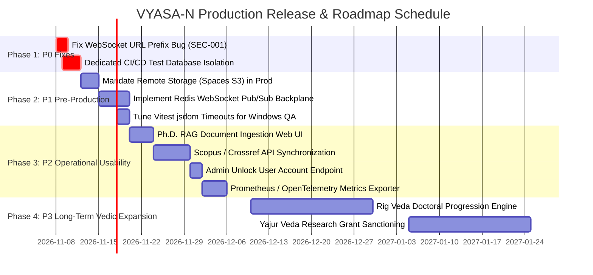

# VYASA-N — PRIORITIZED DEVELOPMENT ROADMAP

**Audit Date:** November 7, 2026  
**Auditor Classification:** Principal Software Architect & Technical Lead  
**Classification Priorities:** P0 (Critical Blocker), P1 (High Production Pre-condition), P2 (Medium Operational Improvement), P3 (Low Future Enhancement)  

---

## 1. Prioritized Work Item Matrix

---

## 2. Granular Milestone Breakdown

### Milestone 1: P0 — Immediate Critical Fixes (Target: 48 Hours)
- **Work Item 1.1: Fix WebSocket Connection Path**
  - *File:* `frontend/src/modules/atharva-veda/nivaran/pages/CommitteeWorkspacePage.tsx#L134`
  - *Action:* Change `/api/v1/modules/.../ws` to `/api/modules/.../ws`.
  - *Outcome:* Real-time committee chat operates without falling back to REST.
- **Work Item 1.2: Provision Isolated Test PostgreSQL Instance in CI/CD**
  - *Action:* Supply `TEST_DATABASE_URL` in Github Actions / Render CI so full 720 pytest backend tests execute on every pull request.

---

### Milestone 2: P1 — High Production Pre-conditions (Target: 2 Weeks)
- **Work Item 2.1: Enforce DigitalOcean Spaces Storage in Production**
  - *File:* `backend/app/core/config.py`
  - *Action:* Add production validator asserting `STORAGE_PROVIDER == 'spaces'`.
  - *Outcome:* Eliminates risk of file loss on ephemeral container hosts.
- **Work Item 2.2: Implement Redis Pub/Sub WebSocket Adapter**
  - *File:* `backend/app/modules/atharva_veda/nivaran/services/committee_chat_ws.py`
  - *Action:* Integrate `redis.asyncio` pub/sub backplane to broadcast socket frames across horizontal multi-worker processes.
- **Work Item 2.3: Vitest Asynchronous Timeout Tuning**
  - *File:* `frontend/vite.config.ts`, `frontend/src/test/setup.ts`
  - *Action:* Configure `testTimeout: 15000` for jsdom test suites under Windows to eliminate the 20 artificial timeout failures.

---

### Milestone 3: P2 — Operational Usability & Monitoring (Target: 1 Month)
- **Work Item 3.1: Ph.D. RAG Ingestion Web UI**
  - *Action:* Add an upload portal in the Admin console allowing university registrars to drag-and-drop new admissions brochures and ordinances for automated vector re-indexing.
- **Work Item 3.2: Automated Citation Synchronization**
  - *Action:* Scheduled background job querying Scopus/Crossref API to auto-populate faculty publications in Sama Veda.
- **Work Item 3.3: Administrative Account Unlock & Lockout Management**
  - *Action:* Provide Super Admins with an instant reset button for accounts temporarily locked out by failed password attempts.
- **Work Item 3.4: Prometheus / OpenTelemetry Integration**
  - *Action:* Expose `/metrics` endpoint formatted for Prometheus scraping and Grafana dashboard visualization.

---

### Milestone 4: P3 — Long-Term Vedic Expansion (Target: Q1 2027)
- **Work Item 4.1: Rig Veda Full Domain Development**
  - Implement doctoral RAC milestone tracking, synopsis anti-plagiarism verification, and examiner pool allocation.
- **Work Item 4.2: Yajur Veda Full Domain Development**
  - Implement research grant accounting, project sanctioning, ethics committee clearance, and faculty incentive calculations.
