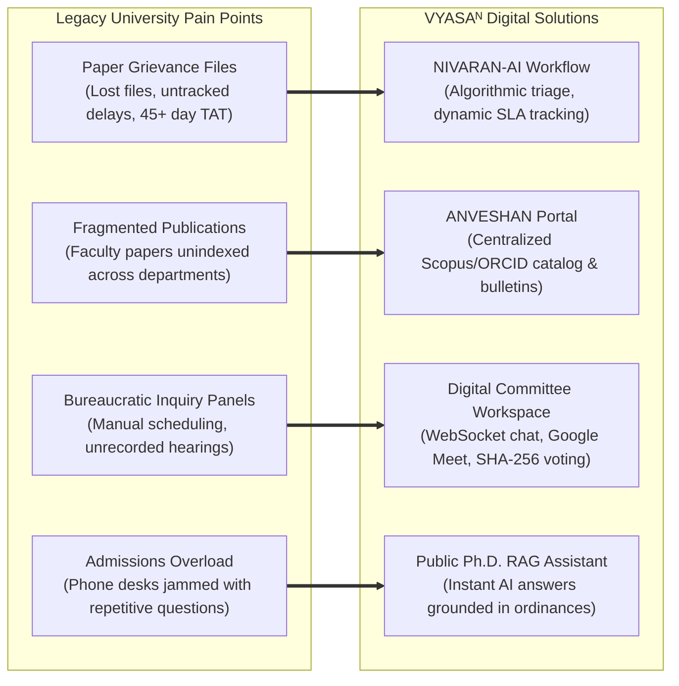
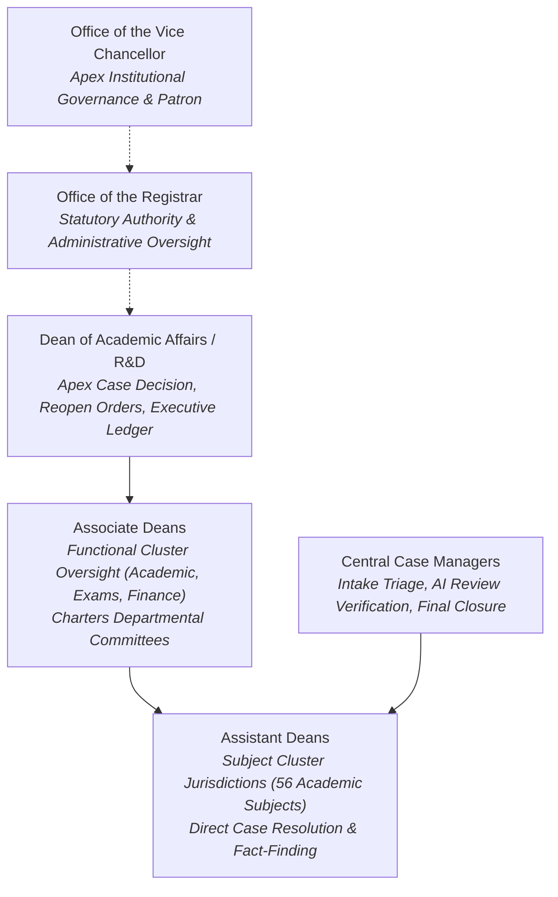
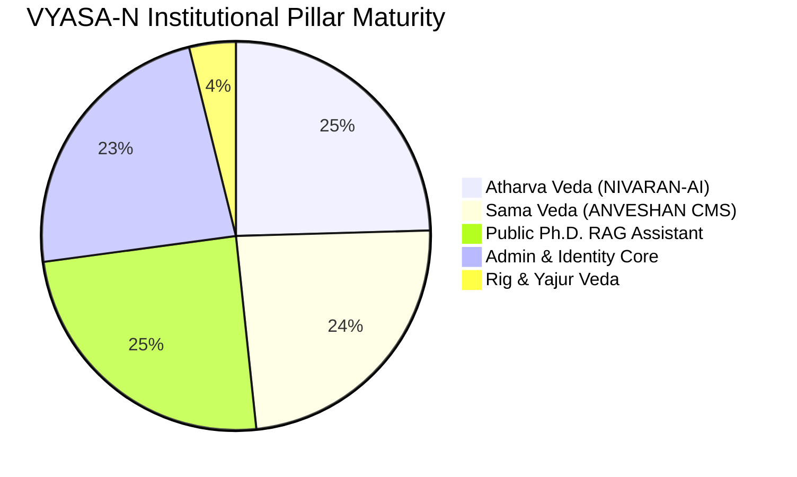

# VYASA-N — INSTITUTIONAL SYSTEM BRIEFING & GOVERNANCE REPORT

**Target Audience:** Vice Chancellor, Registrar, Deans, Directors, Department Heads, Syndicate / Executive Council, Accreditation Bodies (NAAC, NIRF)  
**Host Institution:** Chhatrapati Shahu Ji Maharaj University (CSJMU), Kanpur, Uttar Pradesh, India  
**Document Classification:** Formal Institutional Overview & Digital Governance Strategy  
**Current Audit Date:** November 7, 2026  

---

## 1. Executive Summary

The **Vedic Yield & Academic Synthesis Architecture (VYASAᴺ)** is CSJMU’s institutional digital governance and research platform. Conceptualized to modernize university administration, eradicate paper-based grievance latency, showcase faculty research achievements, and provide artificial intelligence admissions guidance, VYASA-N establishes an integrated digital standard for higher education institutions in India.

The platform unites the four classical Vedic domains into a cohesive software architecture:
1. **Rig Veda:** Foundational research discovery and doctoral progression.
2. **Yajur Veda:** Research project administration, sanctioning, and ethics compliance.
3. **Sama Veda (ANVESHAN):** Research recognition, university bulletins, and cryptographic awards.
4. **Atharva Veda (NIVARAN-AI):** Student and faculty grievance redressal, statutory inquiry panels, and tamper-proof electronic dossier (e-File) sealing.

---

## 2. Institutional Problems Addressed

Prior to the deployment of VYASA-N, the university faced several structural administrative bottlenecks:

1. **Grievance Latency & Opacity:** Student grievances historically took weeks or months traversing departmental desks without clear service level agreements (SLAs). VYASA-N enforces an automated 8-stage lifecycle with precise turn-around-time countdowns.
2. **Untracked Research Outputs:** University research was documented ad-hoc, hindering national ranking submissions (NIRF/NAAC). VYASA-N introduces a central catalog with Scopus and ORCID disambiguation.
3. **Inquiry Panel Inefficiency:** Fact-finding inquiry committees lacked a secure, authenticated workspace for confidential deliberation, virtual hearings, and evidence analysis. VYASA-N provides a dedicated committee suite with cryptographically hashed voting ballots.
4. **Admissions Guidance Bottlenecks:** Prospective scholars flooded admissions desks with queries regarding entrance requirements and coursework rules. VYASA-N deploys a public AI conversational assistant grounded strictly in official university ordinances.

---

## 3. Governance Hierarchy & Administrative Tiers

VYASA-N enforces the university's statutory governance hierarchy, ensuring academic decisions are taken at the appropriate jurisdictional level:

---

## 4. End-to-End Institutional Lifecycles

### A. The Grievance Resolution & Cryptographic Sealing Lifecycle
1. **Intake:** A student submits a complaint through the authenticated portal, uploading supporting affidavits. Gemini OCR automatically transcribes scanned documents.
2. **AI-Assisted Triage:** Central Case Managers verify the machine learning category prediction and SLA target.
3. **Jurisdictional Review:** The case is dispatched algorithmically to the Assistant Dean managing that subject. The Assistant Dean can resolve the matter, request additional student evidence, or petition for an inquiry committee.
4. **Statutory Inquiry (When Required):** An Associate Dean or Dean charters a panel. Members deliberate via private real-time chat, conduct Google Meet hearings, and cast cryptographic ballots.
5. **Resolution & Sealing:** Once resolved, the Case Manager reviews compliance in the closure queue. The system compiles all case notes, evidence, and timestamps into a standardized PDF dossier (e-File), sealed with an immutable SHA-256 digital digest.

### B. Research Recognition & Felicitation
1. **Research Publications Catalog:** Showcases peer-reviewed scientific breakthroughs across university faculties.
2. **Research Bulletins:** Regularly published university bulletins are available for in-browser inspection or download.
3. **Public QR Verification:** Felicitation certificates feature unique verification hashes. External employers and institutions can scan the QR code to confirm certificate authenticity, immediately identifying revoked credentials.

---

## 5. Transparency, Accountability & Auditability

VYASA-N incorporates stringent transparency and accountability controls required by university statutes:
- **Immutable Audit Trail:** Every sensitive institutional action (case reassignments, committee chartering, ballot casting, category overrides, 2FA enrollments) is recorded in an immutable audit ledger with user ID, timestamp, IP address, and before/after snapshots.
- **Strict Role Decoupling:** Technical administrators (`super_admin`) cannot alter active case findings or manipulate student grievances, preserving academic neutrality.
- **Two-Factor Authentication (TOTP):** Mandatory for all university authorities (Deans, Managers) using authenticator apps, protecting administrative accounts against unauthorized access.
- **Student Visibility:** Students can track their case's exact position in the review chain in real time, eliminating bureaucratic opacity.

---

## 6. Implementation Status & Path to Full Rollout

- **Operational Pillars (Ready for Institutional Rollout):**
  - **Atharva Veda (NIVARAN-AI):** Fully functional. 8-stage case lifecycle, AI triage, committee workspace, e-files, and student master records operational.
  - **Sama Veda (ANVESHAN / SAMIKSHA):** Fully functional. Publication catalog, bulletin viewer, author registry, certificate verification, and CMS operational.
  - **Public Ph.D. RAG Assistant:** Fully functional. Public conversational AI grounded in official university documents.
- **Future Pillars (Scheduled for Phase 3):**
  - **Rig Veda:** Doctoral thesis progression, RAC milestone tracking, and synopsis plagiarism verification.
  - **Yajur Veda:** Research grant sanctioning, utilization certificates, and faculty publication incentive accounting.

---

## 7. Institutional Recommendations for University Leadership

1. **Authorize Official Production Launch of NIVARAN & ANVESHAN:** The grievance redressal and research recognition subsystems are verified, stable, and ready to replace legacy paper workflows.
2. **Enforce Mandatory TOTP 2FA Onboarding:** Direct all appointed Assistant Deans, Associate Deans, and Case Managers to complete first-login security onboarding and authenticator app enrollment.
3. **Mandate Digital Certificate QR Verification:** Notify affiliated colleges and prospective employers that all CSJMU research felicitation certificates must be validated through the official public verification portal (`/modules/sama-veda/felicitation`).
4. **Approve Phase 3 Expansion:** Allocate resources for Phase 3 development of Rig Veda (doctoral progression) and Yajur Veda (grant sanctioning) to complete the four-Veda digital vision.
