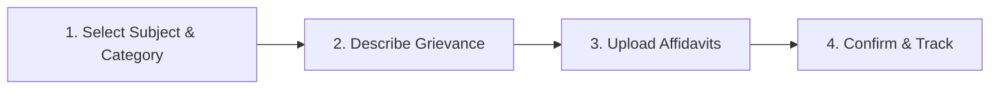

# VYASA-N — APPLICANT & DOCTORAL SCHOLAR HANDBOOK

**Target Audience:** Enrolled Students, Doctoral Researchers, Grievance Applicants  
**Platform Pillar:** Atharva Veda &bull; NIVARAN-AI  
**Document Type:** Practical Step-by-Step User Guide  

---

## 1. Introduction to VYASA-N for Students

Welcome to **VYASAᴺ**, the official digital academic governance and grievance redressal platform of Chhatrapati Shahu Ji Maharaj University (CSJMU), Kanpur.

Through the **NIVARAN** portal, enrolled students and doctoral scholars can submit academic complaints, upload supporting affidavits, track case review progress in real time, communicate with investigating faculty authorities, and download tamper-proof official resolution dossiers (e-Files).

---

## 2. Account Registration & Login

### Step 1: Self-Registration
1. Visit the portal homepage and click **Applicant Portal** or navigate directly to `/applicant/register`.
2. Fill in the required registration fields:
   - **Full Name** (as reflected in university examination records)
   - **Email Address** (will serve as your primary username)
   - **Password** (minimum 8 characters)
   - **Enrollment Number / Roll Number**
   - **Department & Academic Subject** (select from the 56 university subjects)
   - **Admission Year & Current Semester**
3. Click **Create Scholar Account**. Upon success, your account is activated immediately.

### Step 2: Signing In
1. Navigate to `/applicant/login`.
2. Enter your registered email address and password.
3. You will be directed to your personalized **Applicant Dashboard**.

---

## 3. How to Submit a Grievance

1. From your dashboard, click **Submit New Grievance** or navigate to `/modules/atharva-veda/nivaran/submit`.
2. **Step 1 — Academic Taxonomy:**
   - Select your enrolled academic department and discipline.
   - Choose the appropriate grievance category (e.g. *Coursework & Evaluation Discrepancy*, *Synopsis & RAC Delays*, *Fee & Scholarship Disputes*, *Hostel & Facilities*).
3. **Step 2 — Complaint Narrative:**
   - Enter a concise **Grievance Title**.
   - Provide a detailed **Description** explaining dates, relevant roll numbers, and prior departmental communications.
4. **Step 3 — Document Intake & OCR Assistant:**
   - Click **Upload Evidence** to attach scanned affidavits, grade cards, or fee receipts (PDF, PNG, or JPG, maximum 15MB).
   - If you upload a handwritten application or scanned petition, the **AI OCR Assistant** can automatically transcribe the text directly into your complaint narrative.
5. **Step 4 — Review & Submit:**
   - Confirm all details and click **Submit Grievance**.
   - The system immediately assigns a unique tracking identifier (e.g., `NIV-2026-84920`).

> [!NOTE]
> **Active Quota Limit:** To ensure rapid resolution for all scholars, each student is permitted a maximum of **3 active grievances** at any given time. Once a case is officially closed, a new case may be submitted.

---

## 4. Tracking Case Progress & Understanding Statuses

You can track your complaint 24/7 by clicking **My Grievances** or visiting `/modules/atharva-veda/nivaran/my-grievances`.

| Status Code | Plain Language Meaning | What Happens Next? |
| :--- | :--- | :--- |
| **`SUBMITTED`** | Application received successfully. | Case Manager will inspect documents and assign an SLA target. |
| **`UNDER_REVIEW`** | Case Manager is triaging your complaint. | AI classification is verified and routed to your Assistant Dean. |
| **`ASSIGNED_TO_ASSISTANT_DEAN`** | Your subject's Assistant Dean is investigating. | The Assistant Dean examines records or summons evidence. |
| **`AWAITING_DOCUMENT`** | The investigating authority needs additional proof. | You must upload the requested proof to proceed. |
| **`REFERRED_TO_COMMITTEE`** | Case referred to a formal faculty inquiry tribunal. | A multi-member committee is deliberating your case. |
| **`RESOLVED`** | Investigating authority has recorded formal decision. | Case Manager prepares official closure dossier. |
| **`CLOSED`** | Case officially closed and sealed. | Your sealed e-File is ready for download. Rating form unlocked. |
| **`REOPENED`** | The Dean has ordered a re-investigation. | Case re-enters triage under direct executive oversight. |

---

## 5. Responding to Document Clarification Requests

If the investigating Assistant Dean or Associate Dean requires additional proof:
1. You will receive an immediate email and web notification.
2. Open your grievance tracking page. A yellow alert box will display the authority's specific request notes.
3. Click **Upload Requested Document**.
4. Select the file and click **Submit Proof**. The case status immediately returns to active investigation.

---

## 6. Downloading Your Sealed E-File & Rating Resolution

Once your case transitions to `CLOSED`:
1. Navigate to **Sealed Dossiers** or `/modules/atharva-veda/nivaran/e-files`.
2. Locate your case record and click **Download E-File**.
3. You will receive an official, tamper-proof PDF compiling your original complaint, attached exhibits, authority findings, and cryptographic SHA-256 digital seals.
4. **Rate Your Experience:** Provide a 1-to-5 star rating and optional comments. Your feedback helps university leadership evaluate administrative responsiveness.
