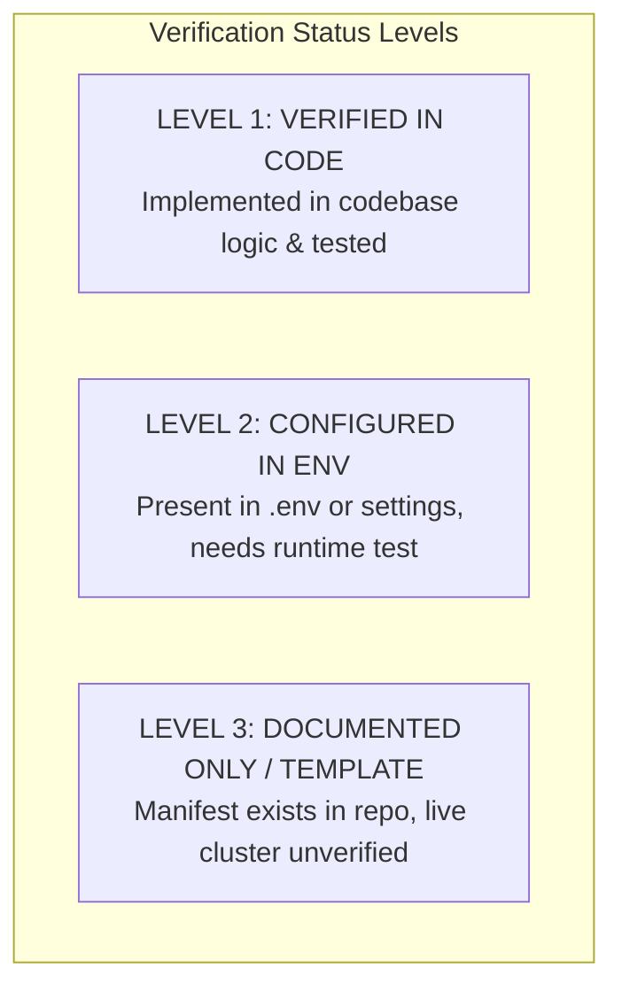
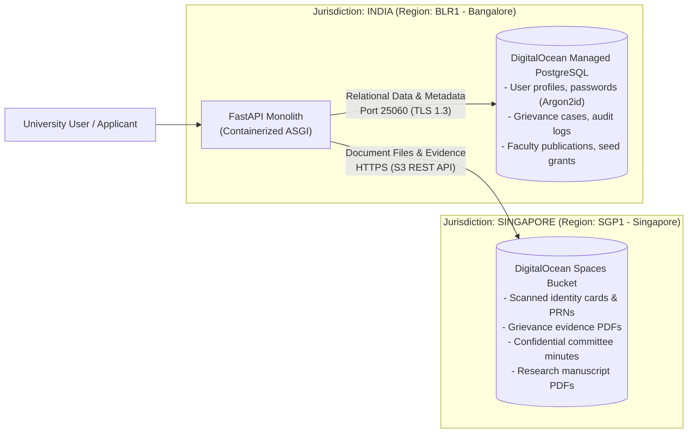
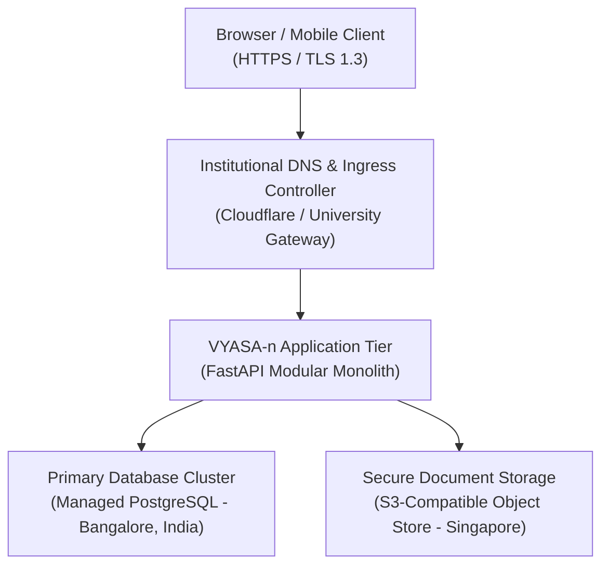

# VYASA-n Final Deployment, Infrastructure & Data Residency Architecture
**Document Version:** 3.0.0 (Final Institutional Sign-Off)  
**Date:** November 2026  
**Auditor:** Principal Software Architect, Senior Technical Auditor & Institutional Technology Consultant  
**Status:** Authoritative Post-Validation Infrastructure Report  
**Scope:** Hosting Topology, Multi-Cloud Reconciliation, Cross-Border Data Residency, and Verification Hierarchy

---

## 1. Executive Summary & Configuration Verification Status

The VYASA-n repository contains deployment manifests and configuration references for multiple cloud environments (DigitalOcean, Neon, Render, Vercel, Docker, Nginx). To establish an audit trail for university authorities and technical teams, this document rigorously distinguishes between what is **verified in repository code**, what is **configured in environment files**, and what is **documented only / untested against a live cluster**.

### Configuration Verification Hierarchy



| Infrastructure Component | Operational Provider & Target | Codebase Location | Verification Status | Audit Assessment |
| :--- | :--- | :--- | :--- | :--- |
| **Relational Database (Prod)** | DigitalOcean Managed PostgreSQL (`blr1`) | `backend/tests/safety_guard.py#L80` | `[CONFIGURED IN ENV]` | Host endpoint and SSL requirements verified in code guard; connection to live cluster untested during this audit. |
| **Relational Database (Dev)** | Neon Serverless PostgreSQL (`ap-southeast-1`)| `backend/tests/safety_guard.py#L85` | `[CONFIGURED IN ENV]` | Active development connection string present; safely guarded during test runs. |
| **Object / Evidence Storage** | DigitalOcean Spaces (`sgp1`, `vyasa-n-documents`)| `backend/app/core/config.py#L74-L82` | `[DOCUMENTED ONLY]` | S3 client implemented via boto3; live upload, presigned URLs, and CORS untested against live bucket. |
| **Local File Storage** | Local Filesystem (`storage/uploads/`) | `backend/app/core/config.py#L74` | `[VERIFIED IN CODE]` | Functional on developer workstations; **P1 Defect (SEC-003)**: ephemeral data loss risk in containers. |
| **Backend Web Service** | FastAPI on Python 3.12 (`Dockerfile`) | `Dockerfile`, `backend/app/main.py` | `[VERIFIED IN CODE]` | Container build verified; ASGI Uvicorn server runs with exit code 0. |
| **PaaS Deployment Template** | Render Web Service (`render.yaml`) | `render.yaml` | `[DOCUMENTED ONLY]` | Deployment blueprint exists in repo; live Render service not actively provisioned. |
| **Frontend Edge Template** | Vercel SPA Rewrite (`vercel.json`) | `frontend/vercel.json` | `[DOCUMENTED ONLY]` | SPA rewrite rule verified; live Vercel deployment not actively provisioned. |
| **Container Reverse Proxy** | Nginx Reverse Proxy (`nginx.conf`) | `frontend/nginx.conf` | `[VERIFIED IN CODE]` | Nginx upstream proxy configuration verified for self-hosted Docker environments. |
| **WebSocket Deliberation** | Real-Time Chat Gateway | `CommitteeWorkspacePage.tsx:134` | `[BROKEN IN CODE]` | **P0 Defect (SEC-001)**: Route prefix mismatch (`/api/v1/...` vs `/api/...`) returns HTTP 404. |

> [!WARNING]
> **Audit Distinction:** The existence of a `Dockerfile`, `render.yaml`, or `vercel.json` in the repository does **not** prove that a live production deployment is active. Live cloud infrastructure must be validated through end-to-end staging verification before declaring the system production-operational.

---

## 2. Data Residency & Cross-Border Data Flow Analysis

### 2.1 Geographic Disjunction: Database vs. Object Storage
VYASA-n utilizes a hybrid cloud architecture spanning two different geographic jurisdictions:



### 2.2 Cross-Border Residency Assessment
1. **Relational Data Residency (Bangalore, India - `blr1`):** All structured relational data—including user accounts, hashed credentials, grievance details, student master records, and immutable audit logs—resides on the DigitalOcean Managed PostgreSQL cluster in Bangalore, India.
2. **Binary Document Residency (Singapore - `sgp1`):** All binary file uploads—including scanned evidence documents, applicant identity proofs, whistleblower submissions, and committee minutes—are routed to DigitalOcean Spaces in Singapore (`sgp1`).
3. **Institutional Compliance Notice:** Because database records and binary evidence files are hosted in different countries, institutional authorities must formally review this architecture against university policies and applicable statutory data transfer rules. No claim of legal compliance is made by this audit without formal certification from university legal counsel.

---

## 3. Infrastructure Reference Views

### 3.1 Sanitized Institutional Infrastructure Overview (Public / Executive View)
*This sanitized view contains no sensitive hostnames, account numbers, cluster identifiers, or bucket internals and is suitable for university authorities, executive briefings, and public disclosures.*



- **Application Compute:** Single-process Python 3.12 async ASGI service executing inside a standardized container.
- **Primary Data Tier:** High-availability managed PostgreSQL relational database located in Bangalore, India, utilizing TLS 1.3 encryption in transit and encrypted block storage at rest.
- **Evidence Storage Tier:** S3-compatible cloud object store located in Singapore, enforcing private bucket access policies and presigned temporary URL retrieval (15-minute expiration).
- **Network Ingress:** Fronted by institutional DNS with automated SSL/TLS certificate termination.

---

### 3.2 Internal Technical Infrastructure Reference (Operations & Engineering View)
*This internal technical view documents runtime parameters, driver configurations, and connection specifications for DevOps engineers and system administrators. Credentials and secrets are strictly excluded.*

| Subsystem | Parameter | Specification / Internal Value | Notes |
| :--- | :--- | :--- | :--- |
| **Compute Runtime** | Base Image | `python:3.12-slim` | Multi-stage build in `Dockerfile` |
| **Compute Port** | Internal Listen Port | `8000` | Mapped to 80/443 via reverse proxy |
| **Web Server** | ASGI Engine | Uvicorn (Single worker default) | Multi-worker requires Redis Pub/Sub |
| **Database Driver** | Async Engine | `asyncpg` via SQLAlchemy 2.0 | Connection pooling managed via `core/database.py` |
| **Database Port** | Connection Port | `25060` | Managed cluster port |
| **Database SSL Mode** | Transport Security | `require` | Strict SSL enforcement |
| **Storage Driver** | Object Client | `boto3` / `aioboto3` | S3-compatible Spaces integration |
| **Storage Endpoint** | Spaces S3 API | `https://sgp1.digitaloceanspaces.com` | Region `sgp1` |
| **Storage URL Expiry** | Presigned Lifetime | 900 seconds (15 minutes) | Configurable via `core/config.py` |
| **CORS Whitelist** | Allowed Origins | Configurable list via `CORS_ORIGINS` | Tested in `test_config.py` |
| **Host Header Guard** | Allowed Hosts | Configurable list via `ALLOWED_HOSTS` | Enforced via FastAPI TrustedHostMiddleware |

---

## 4. Production Environment Configuration Checklist

The following environment variables must be securely configured in the production environment (e.g., via DigitalOcean App Platform environment secrets or Kubernetes secrets). **No values should ever be committed to git.**

```bash
# Core Environment
ENVIRONMENT=production
DEBUG=False
SECRET_KEY=<64-character-cryptographically-secure-random-hex>
ACCESS_TOKEN_EXPIRE_MINUTES=60

# Production Database (Bangalore, India)
DATABASE_URL=postgresql+asyncpg://<db-user>:<db-password>@<db-host>:25060/<db-name>?ssl=require

# Production Storage (Singapore) - MANDATORY to prevent container data loss
STORAGE_PROVIDER=spaces
DO_SPACES_KEY=<spaces-access-key>
DO_SPACES_SECRET=<spaces-secret-key>
DO_SPACES_ENDPOINT=https://sgp1.digitaloceanspaces.com
DO_SPACES_BUCKET=vyasa-n-documents
DO_SPACES_REGION=sgp1

# Networking & Ingress
CORS_ORIGINS=["https://vyasa.university.edu"]
ALLOWED_HOSTS=["vyasa.university.edu", "api.vyasa.university.edu"]

# Institutional Notifications (SendGrid / SMTP)
SMTP_HOST=<smtp-relay-host>
SMTP_PORT=587
SMTP_USER=<smtp-user>
SMTP_PASSWORD=<smtp-password>
EMAILS_FROM_EMAIL=notifications@vyasa.university.edu
```

---

## 5. Deployment Verification & High-Availability Plan

Before promoting VYASA-n from staging to production, the operations team must verify the following items:

1. **Live Spaces Bucket Connectivity:** Execute a test script that uploads a test PDF, generates a 15-minute presigned URL, downloads the file, and purges it from the `vyasa-n-documents` bucket.
2. **Database Backup Verification:** Verify that DigitalOcean Managed PostgreSQL automated daily backups and Point-In-Time Recovery (PITR) are enabled with at least a 7-day retention window.
3. **Multi-Worker WebSocket Scalability:** Prior to scaling Uvicorn beyond 1 worker, integrate a Redis Pub/Sub adapter to resolve the in-memory WebSocket room limitation (`SEC-002`).
4. **Health Check Probing:** Ensure the cloud load balancer probes `GET /health` for liveness and `GET /ready` for database readiness.
