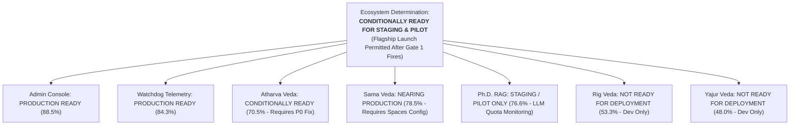

# VYASA-n Master Documentation Index & Institutional Sign-Off
**Document Version:** 3.0.0 (Final Institutional Sign-Off)  
**Date:** November 2026  
**Auditor:** Principal Software Architect, Senior Technical Auditor & Institutional Technology Consultant  
**Status:** Authoritative Ecosystem Documentation Index  
**Institution:** Chhatrapati Shahu Ji Maharaj University (CSJMU), Kanpur  

---

## 1. Authoritative Institutional Sign-Off Deliverables (Version 3.0.0)

The following six documents represent the final, reconciled, and mathematically audited assessment of the VYASA-n ecosystem, prepared for university leadership, technical engineering teams, and institutional governance bodies:

| Final Deliverable | Path | Primary Purpose & Key Verified Findings |
| :--- | :--- | :--- |
| **1. Final Validated Audit Report** | [`FINAL_VALIDATED_AUDIT_REPORT.md`](file:///c:/Projects/VYASA/docs/FINAL_VALIDATED_AUDIT_REPORT.md) | Master institutional audit report uniting the reconciled feature census (106 features), empirical test results (743 backend, 502 frontend), interface inventory, and deployment assessment. |
| **2. Final Production Readiness** | [`FINAL_PRODUCTION_READINESS.md`](file:///c:/Projects/VYASA/docs/FINAL_PRODUCTION_READINESS.md) | Mathematical IPRF-6D evaluation across 6 weighted dimensions with $-15.0\text{ pp}$ (P0) and $-5.0\text{ pp}$ (P1) deductions. Includes the 6-finding release blocker matrix and gate criteria. |
| **3. Final Deployment Architecture** | [`FINAL_DEPLOYMENT_ARCHITECTURE.md`](file:///c:/Projects/VYASA/docs/FINAL_DEPLOYMENT_ARCHITECTURE.md) | Multi-cloud reconciliation: DigitalOcean Managed PostgreSQL (Bangalore `blr1`) & Spaces (`sgp1`) vs Neon dev sandbox vs Render/Vercel templates. Cross-border data flow disclosures. |
| **4. Final Feature Status Matrix** | [`FINAL_FEATURE_STATUS_MATRIX.md`](file:///c:/Projects/VYASA/docs/FINAL_FEATURE_STATUS_MATRIX.md) | Mathematically closed inventory of exactly **106 unique capabilities** (88 Implemented, 8 Partially Implemented, 4 UI Only, 2 Backend Only, 2 Broken, 2 Architectural Boundary; zero double-counting). |
| **5. Final Testing Report** | [`FINAL_TESTING_REPORT.md`](file:///c:/Projects/VYASA/docs/FINAL_TESTING_REPORT.md) | Empirical test breakdown: **743 backend tests collected** (411 passed db-free, 1 failed, 1 skipped, 6 setup-errored via safety guard, 325 blocked); **502 frontend tests** (499 passed, 3 failed, build clean). |
| **6. Final Documentation Index** | [`FINAL_DOCUMENTATION_INDEX.md`](file:///c:/Projects/VYASA/docs/FINAL_DOCUMENTATION_INDEX.md) | Master documentation sitemap, institutional sign-off record, and repository audit history. (This file). |

---

## 2. Institutional Readiness Determination Summary

### Executive Metric Baseline:
- **Active Flagship Core:** **83.8% raw score** $\rightarrow$ **63.8% final score** after absolute percentage-point deductions ($-15.0\text{ pp}$ for P0 WebSocket mismatch, $-5.0\text{ pp}$ for P1 ephemeral storage default).
- **Full Ecosystem Vision:** **74.2% raw score** $\rightarrow$ **54.2% final score** (unweighted) / **79.7% raw** $\rightarrow$ **59.7% final** (feature-weighted).
- **Feature Census:** 106 total features (88 Implemented, 8 Partially Implemented, 4 UI Only, 2 Backend Only, 2 Broken, 2 Architectural Boundary).
- **Automated Tests:** 1,245 total tests collected; 920 executed; **910 passed (98.9% pass rate of executed)**; 4 failed; 1 skipped; 331 blocked/guarded.
- **Production Build:** TypeScript 5.8 / Vite 6 compiles cleanly with 0 errors across 262 modules in 429ms.

---

## 3. Repository Documentation Archive & Historical Snapshots

All previous audit documentation has been preserved in the repository to provide a transparent audit trail:

### Pass 2 Validated Artifacts (Version 2.0.0)
- [`VALIDATED_AUDIT_REPORT.md`](file:///c:/Projects/VYASA/docs/VALIDATED_AUDIT_REPORT.md)
- [`06-quality-and-readiness/feature-status-matrix-validated.md`](file:///c:/Projects/VYASA/docs/06-quality-and-readiness/feature-status-matrix-validated.md)
- [`06-quality-and-readiness/testing-assessment-validated.md`](file:///c:/Projects/VYASA/docs/06-quality-and-readiness/testing-assessment-validated.md)
- [`06-quality-and-readiness/production-readiness-validated.md`](file:///c:/Projects/VYASA/docs/06-quality-and-readiness/production-readiness-validated.md)
- [`02-architecture/deployment-architecture-validated.md`](file:///c:/Projects/VYASA/docs/02-architecture/deployment-architecture-validated.md)
- [`DOCUMENTATION_QUALITY_AND_CONSISTENCY_REPORT.md`](file:///c:/Projects/VYASA/docs/DOCUMENTATION_QUALITY_AND_CONSISTENCY_REPORT.md)
- [`UNRESOLVED_QUESTIONS_AND_EVIDENCE_GAPS.md`](file:///c:/Projects/VYASA/docs/UNRESOLVED_QUESTIONS_AND_EVIDENCE_GAPS.md)

### Pass 1 Baseline Snapshot (Version 1.0.0)
- **Master Index:** [`README.md`](file:///c:/Projects/VYASA/docs/README.md)
- **01 System Overview:** [`executive-summary.md`](file:///c:/Projects/VYASA/docs/01-system-overview/executive-summary.md), [`platform-overview.md`](file:///c:/Projects/VYASA/docs/01-system-overview/platform-overview.md), [`module-inventory.md`](file:///c:/Projects/VYASA/docs/01-system-overview/module-inventory.md), [`user-roles.md`](file:///c:/Projects/VYASA/docs/01-system-overview/user-roles.md), [`system-workflows.md`](file:///c:/Projects/VYASA/docs/01-system-overview/system-workflows.md)
- **02 Architecture:** [`system-architecture.md`](file:///c:/Projects/VYASA/docs/02-architecture/system-architecture.md), [`frontend-architecture.md`](file:///c:/Projects/VYASA/docs/02-architecture/frontend-architecture.md), [`backend-architecture.md`](file:///c:/Projects/VYASA/docs/02-architecture/backend-architecture.md), [`database-architecture.md`](file:///c:/Projects/VYASA/docs/02-architecture/database-architecture.md), [`storage-architecture.md`](file:///c:/Projects/VYASA/docs/02-architecture/storage-architecture.md), [`deployment-architecture.md`](file:///c:/Projects/VYASA/docs/02-architecture/deployment-architecture.md), [`er-diagram.md`](file:///c:/Projects/VYASA/docs/02-architecture/diagrams/er-diagram.md)
- **03 Modules:** [`atharva-veda-nivaran.md`](file:///c:/Projects/VYASA/docs/03-modules/atharva-veda-nivaran.md), [`sama-veda-samiksha.md`](file:///c:/Projects/VYASA/docs/03-modules/sama-veda-samiksha.md), [`phd-admission-rag.md`](file:///c:/Projects/VYASA/docs/03-modules/phd-admission-rag.md), [`administration-console.md`](file:///c:/Projects/VYASA/docs/03-modules/administration-console.md), [`rig-veda.md`](file:///c:/Projects/VYASA/docs/03-modules/rig-veda.md), [`yajur-veda.md`](file:///c:/Projects/VYASA/docs/03-modules/yajur-veda.md), [`watchdog-and-telemetry.md`](file:///c:/Projects/VYASA/docs/03-modules/watchdog-and-telemetry.md)
- **04 API Reference:** [`api-inventory.md`](file:///c:/Projects/VYASA/docs/04-api-reference/api-inventory.md), [`endpoint-reference.md`](file:///c:/Projects/VYASA/docs/04-api-reference/endpoint-reference.md)
- **05 Security:** [`security-assessment.md`](file:///c:/Projects/VYASA/docs/05-security/security-assessment.md), [`access-control-matrix.md`](file:///c:/Projects/VYASA/docs/05-security/access-control-matrix.md)
- **06 Quality & Readiness:** [`feature-status-matrix.md`](file:///c:/Projects/VYASA/docs/06-quality-and-readiness/feature-status-matrix.md), [`testing-assessment.md`](file:///c:/Projects/VYASA/docs/06-quality-and-readiness/testing-assessment.md), [`gap-analysis.md`](file:///c:/Projects/VYASA/docs/06-quality-and-readiness/gap-analysis.md), [`development-roadmap.md`](file:///c:/Projects/VYASA/docs/06-quality-and-readiness/development-roadmap.md)
- **07 Authorities:** [`institutional-system-documentation.md`](file:///c:/Projects/VYASA/docs/07-authorities/institutional-system-documentation.md)
- **08 Technical Team:** [`technical-documentation.md`](file:///c:/Projects/VYASA/docs/08-technical-team/technical-documentation.md), [`development-setup.md`](file:///c:/Projects/VYASA/docs/08-technical-team/development-setup.md), [`deployment-runbook.md`](file:///c:/Projects/VYASA/docs/08-technical-team/deployment-runbook.md), [`troubleshooting.md`](file:///c:/Projects/VYASA/docs/08-technical-team/troubleshooting.md)
- **09 User Handbook:** [`applicant-handbook.md`](file:///c:/Projects/VYASA/docs/09-user-handbook/applicant-handbook.md), [`researcher-handbook.md`](file:///c:/Projects/VYASA/docs/09-user-handbook/researcher-handbook.md), [`administrator-handbook.md`](file:///c:/Projects/VYASA/docs/09-user-handbook/administrator-handbook.md)

---

## 4. Final Verification Checklists & Release Gate

Institutional authorities and technical leadership can sign off on staging and production deployment by executing the following gate checks:

### Gate 1: Pre-Release Remediation Sprint (Mandatory for Launch)
- [ ] Patch `CommitteeWorkspacePage.tsx#L134` from `/api/v1/...` to `/api/...` to resolve P0 blocker `SEC-001`.
- [ ] Set `STORAGE_PROVIDER="spaces"` with live DigitalOcean Spaces credentials to prevent container file loss (`SEC-003`).
- [ ] Update `src/admin/__tests__/samaAdminPages.test.tsx` with mock implementations for `getCertificateStats` and `getTemplates` (`SEC-005`).
- [ ] Update `test_config.py` CORS origin assertion (`SEC-004`).

### Gate 2: Staging Verification & Multi-Worker Validation
- [ ] Spin up containerized PostgreSQL instance and run all 325 safety-blocked integration tests.
- [ ] Verify live file upload and presigned download against DigitalOcean Spaces `vyasa-n-documents` bucket.
- [ ] Evaluate Redis Pub/Sub deployment if Uvicorn is scaled to multiple worker processes (`SEC-002`).

### Gate 3: Production Sign-Off & Cutover
- [ ] Disable Rig Veda and Yajur Veda via environment flags (`ENABLE_RIG_VEDA=false`, `ENABLE_YAJUR_VEDA=false`).
- [ ] Verify DigitalOcean Bangalore Managed PostgreSQL automated backups and 7-day PITR retention.
- [ ] Conduct executive walkthrough with university authorities (Vice Chancellor, Registrar, Deans).
