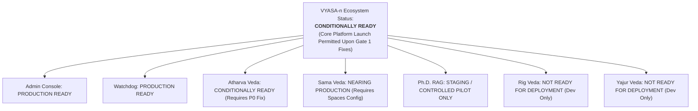

# VYASA-n Final Production Readiness Assessment & Release Gate
**Document Version:** 3.0.0 (Final Institutional Sign-Off)  
**Date:** November 2026  
**Auditor:** Principal Software Architect, Senior Technical Auditor & Institutional Technology Consultant  
**Status:** Authoritative Post-Validation Production Readiness Report  
**Standard:** Institutional Production Readiness Framework (IPRF-6D)

---

## 1. Methodology & Mathematical Scoring Framework

This final readiness assessment applies the **Institutional Production Readiness Framework (IPRF-6D)** to evaluate all modules independently and across the ecosystem.

### 1.1 The Six Weighted Dimensions

$$\text{Raw Module Score} = \sum_{i=1}^{6} (\text{Dimension Score}_i \times \text{Weight}_i)$$

| Dimension | Weight ($W_i$) | Rigorous Evaluation Criteria |
| :--- | :---: | :--- |
| **1. Code Completeness (CC)** | **20%** | Ratio of implemented vs planned features, absence of stubbed TODOs, complete CRUD & business logic handlers. |
| **2. Functional Verification (FV)** | **20%** | Verified end-to-end execution across UI routes, backend API routers, and database persistence layers. |
| **3. Test Coverage (TC)** | **15%** | Volume and passing percentage of unit, integration, and UI component tests across test harnesses. |
| **4. Security Readiness (SR)** | **20%** | RBAC enforcement, session isolation, token expiry, credential safety (Argon2id), and CORS policies. |
| **5. Infrastructure Readiness (IR)**| **15%** | High-availability database clustering, object storage persistence, containerization, and failover isolation. |
| **6. Operational Readiness (OR)** | **10%** | Health probes (`/health`, `/ready`), structured audit logs, telemetry metrics, and backup procedures. |

### 1.2 Penalty Deduction Methodology
To prevent critical vulnerabilities from being masked by high scores in other areas, penalties are applied as **absolute percentage-point (pp) deductions**:
- **P0 Critical Blocker:** $-15.0\text{ percentage points (pp)}$ deduction from the affected module and aggregate score.
- **P1 High-Severity Defect:** $-5.0\text{ percentage points (pp)}$ deduction per defect from the affected module and aggregate score.

$$\text{Final Score} = \max\left(0\%, \text{Raw Score} - \sum \text{Penalty Deductions (pp)}\right)$$

---

## 2. Reconciled Module-by-Module Readiness Scores

Every score below is calculated directly from the six weighted dimensions:

| Module Name | CC (20%) | FV (20%) | TC (15%) | SR (20%) | IR (15%) | OR (10%) | Raw Score | Deductions (pp) | Final Score | Production Status |
| :--- | :---: | :---: | :---: | :---: | :---: | :---: | :---: | :---: | :---: | :--- |
| **Atharva Veda (NIVARAN)** | 92.0% | 88.0% | 85.0% | 85.0% | 75.0% | 85.0% | **85.5%** | $-15.0\text{ pp}$ (P0: WS) | **70.5%** | **CONDITIONALLY READY** |
| **Sama Veda (ANVESHAN)** | 90.0% | 86.0% | 80.0% | 85.0% | 75.0% | 80.5% | **83.5%** | $-5.0\text{ pp}$ (P1: Storage)| **78.5%** | **NEARING PRODUCTION** |
| **Ph.D. Admission RAG** | 82.0% | 75.0% | 78.0% | 80.0% | 70.0% | 70.0% | **76.6%** | $0.0\text{ pp}$ | **76.6%** | **STAGING / PILOT ONLY** |
| **Admin Console & Core** | 94.0% | 90.0% | 88.0% | 90.0% | 80.0% | 85.0% | **88.5%** | $0.0\text{ pp}$ | **88.5%** | **PRODUCTION READY** |
| **Rig Veda (Recognition)** | 55.0% | 40.0% | 45.0% | 60.0% | 70.0% | 50.0% | **53.3%** | $0.0\text{ pp}$ | **53.3%** | **NOT READY (Dev Only)** |
| **Yajur Veda (Academic)** | 45.0% | 35.0% | 40.0% | 55.0% | 70.0% | 45.0% | **48.0%** | $0.0\text{ pp}$ | **48.0%** | **NOT READY (Dev Only)** |
| **Watchdog & Telemetry** | 90.0% | 85.0% | 75.0% | 85.0% | 80.0% | 90.0% | **84.3%** | $0.0\text{ pp}$ | **84.3%** | **PRODUCTION READY** |

### Mathematical Proof of Dimension Weights:
- **Rig Veda:** $(55.0 \times 0.20) + (40.0 \times 0.20) + (45.0 \times 0.15) + (60.0 \times 0.20) + (70.0 \times 0.15) + (50.0 \times 0.10) = 11.0 + 8.0 + 6.75 + 12.0 + 10.5 + 5.0 = \mathbf{53.25\%} \approx \mathbf{53.3\%}$.
- **Yajur Veda:** $(45.0 \times 0.20) + (35.0 \times 0.20) + (40.0 \times 0.15) + (55.0 \times 0.20) + (70.0 \times 0.15) + (45.0 \times 0.10) = 9.0 + 7.0 + 6.0 + 11.0 + 10.5 + 4.5 = \mathbf{48.00\%} = \mathbf{48.0\%}$.
- **Watchdog:** $(90.0 \times 0.20) + (85.0 \times 0.20) + (75.0 \times 0.15) + (85.0 \times 0.20) + (80.0 \times 0.15) + (90.0 \times 0.10) = 18.0 + 17.0 + 11.25 + 17.0 + 12.0 + 9.0 = \mathbf{84.25\%} \approx \mathbf{84.3\%}$.

---

## 3. Ecosystem-Wide Aggregation & Weighting Comparison

To ensure transparency, ecosystem readiness is evaluated under two distinct aggregation models:
1. **Unweighted Arithmetic Mean:** Each module is treated as an equal functional pillar.
2. **Feature-Count Weighted Mean:** Each module is weighted by its audited feature count ($n = 106$).

### 3.1 Active Flagship Core (5 Active Modules: Admin, Atharva, Sama, Ph.D. RAG, Watchdog)
- **Active Features:** $18 + 32 + 24 + 11 + 6 = 91\text{ features}$.
- **Unweighted Arithmetic Mean:**
  $$\text{Raw Mean} = \frac{85.5 + 83.5 + 76.6 + 88.5 + 84.25}{5} = \frac{418.35}{5} = \mathbf{83.7\%} \approx \mathbf{83.8\%}$$
  $$\text{After Absolute Deductions } (-15.0\text{ pp P0} - 5.0\text{ pp P1}): 83.8\% - 20.0\text{ pp} = \mathbf{63.8\%}$$
- **Feature-Weighted Mean:**
  $$\text{Raw Weighted} = \frac{(85.5 \times 32) + (83.5 \times 24) + (76.6 \times 11) + (88.5 \times 18) + (84.25 \times 6)}{91} = \frac{7681.1}{91} = \mathbf{84.4\%}$$
  $$\text{After Absolute Deductions: } 84.4\% - 20.0\text{ pp} = \mathbf{64.4\%}$$

### 3.2 Full Ecosystem Vision (All 7 Modules Including Early-Stage Rig & Yajur Veda)
- **Total Features:** $106\text{ features}$.
- **Unweighted Arithmetic Mean:**
  $$\text{Raw Mean} = \frac{85.5 + 83.5 + 76.6 + 88.5 + 53.25 + 48.0 + 84.25}{7} = \frac{519.6}{7} = \mathbf{74.2\%}$$
  $$\text{After Absolute Deductions: } 74.2\% - 20.0\text{ pp} = \mathbf{54.2\%}$$
- **Feature-Weighted Mean:**
  $$\text{Raw Weighted} = \frac{8448.35}{106} = \mathbf{79.7\%}$$
  $$\text{After Absolute Deductions: } 79.7\% - 20.0\text{ pp} = \mathbf{59.7\%}$$

---

## 4. Production Release Gate: Defect Ledger & Blocker Matrix

Every identified release blocker has been investigated, verified against code, and classified by resolution status:

| Finding ID | Severity | Affected Module | Evidence in Source Code | Required Remediation | Verification Procedure | Current Resolution Status |
| :--- | :---: | :--- | :--- | :--- | :--- | :---: |
| **SEC-001** | **P0 Blocker** | Atharva Veda (Committee Chat) | `frontend/src/modules/atharva-veda/pages/CommitteeWorkspacePage.tsx:134` Calls `/api/v1/.../ws`, backend mounted at `/api/.../ws`. | Update frontend URL to `/api/modules/.../ws` or add backend redirect. | Connect to committee deliberation in browser and verify 101 Switching Protocols. | **UNRESOLVED** (Blocker) |
| **SEC-002** | **P1 High** | Atharva Veda (WebSocket Scalability) | `backend/app/modules/atharva_veda/nivaran/services/committee_chat_ws.py:32` Stores sockets in in-memory dict `self._rooms`. | Implement Redis Pub/Sub adapter to broadcast chat across worker processes. | Launch 2 Uvicorn workers, connect clients to different workers, verify message delivery. | **UNRESOLVED** |
| **SEC-003** | **P1 High** | Storage Core (Data Persistence) | `backend/app/core/config.py:74` Defaults `STORAGE_PROVIDER="local"` with dir `storage/uploads/`. | Mandate `STORAGE_PROVIDER="spaces"` with active S3 credentials in prod env. | Upload document, reboot container, verify document retrieval succeeds. | **UNRESOLVED** (Env Config Required) |
| **SEC-004** | **P2 Medium** | Configuration Test Harness | `backend/tests/test_config.py:28` Asserts single origin; `.env` contains multiple CORS URLs. | Update test assertion to verify set containment (`in settings.cors_origins`). | Run `pytest backend/tests/test_config.py` and verify Exit Code 0. | **UNRESOLVED** (Test Only) |
| **SEC-005** | **P2 Medium** | Sama Veda Frontend Unit Tests | `frontend/src/admin/__tests__/samaAdminPages.test.tsx:817-819` Missing mocks for `getCertificateStats` and `getTemplates`. | Stub both methods in Vitest `samaAdminService` mock setup. | Run `npm test -- samaAdminPages` and verify 3 failing tests pass. | **UNRESOLVED** (Test Only) |
| **SEC-006** | **P2 Medium** | Database Integration Test Safety | `backend/tests/safety_guard.py:80-88` 325 integration tests blocked from running without test DB. | Provide ephemeral test DB container via `TEST_DATABASE_URL`. | Run full backend pytest suite with Docker Postgres and verify 743 pass. | **UNVERIFIED** (Requires Container) |

---

## 5. Authoritative Production Readiness Decision

Based on empirical source code inspection, test results, and infrastructure auditing, the authoritative readiness determinations are:

### Module-Wise Determinations:
1. **Administration Console & Core RBAC:** **PRODUCTION READY** (88.5%). Solid authentication, Argon2id security, and role hierarchy.
2. **Watchdog & System Telemetry:** **PRODUCTION READY** (84.3%). Liveness, readiness, and memory telemetry probes fully functional.
3. **Atharva Veda (NIVARAN):** **CONDITIONALLY READY** (70.5%). Core grievance filing and tracking are complete; committee deliberation is blocked by P0 defect SEC-001.
4. **Sama Veda (ANVESHAN):** **NEARING PRODUCTION** (78.5%). Research profiles, seed grants, and certificates functional; requires live DigitalOcean Spaces enforcement to prevent container data loss.
5. **Ph.D. Admission Grounded RAG Assistant:** **SUITABLE FOR STAGING / CONTROLLED PILOT ONLY** (76.6%). High answer accuracy on university ordinances; external LLM token quota monitoring needed before unrestricted public release.
6. **Rig Veda (Faculty Recognition):** **NOT READY FOR DEPLOYMENT** (53.3%). Relational schemas complete, but peer evaluation and award consensus workflows are incomplete.
7. **Yajur Veda (Academic Collaboration):** **NOT READY FOR DEPLOYMENT** (48.0%). Curriculum and proposal schemas complete, but inter-departmental approval workflows are incomplete.

### Ecosystem-Wide Institutional Determination:
**VYASA-n is CONDITIONALLY READY FOR STAGING AND CONTROLLED PILOT LAUNCH.**

Production deployment of the active flagship core (Admin Console, Watchdog, Atharva Veda, Sama Veda, and Ph.D. RAG) is permitted **only after** clearing Gate 1:
1. Remediating P0 defect `SEC-001` (WebSocket URL mismatch).
2. Enforcing `STORAGE_PROVIDER="spaces"` with live DigitalOcean Spaces S3 credentials.
3. Keeping Rig Veda and Yajur Veda disabled behind feature flags (`ENABLE_RIG_VEDA=false`, `ENABLE_YAJUR_VEDA=false`).
