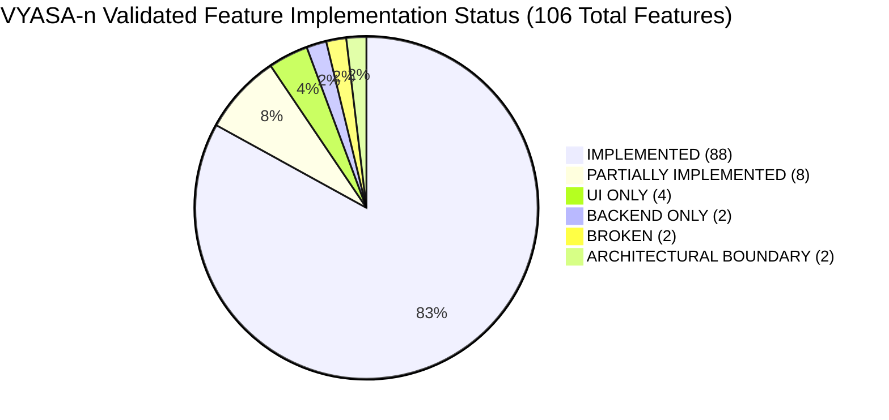
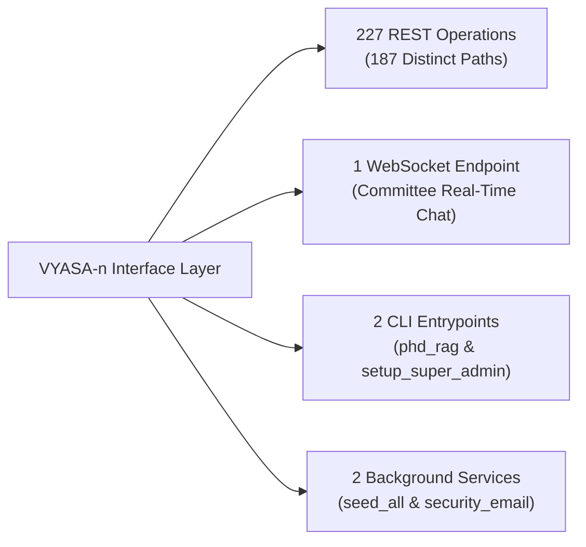
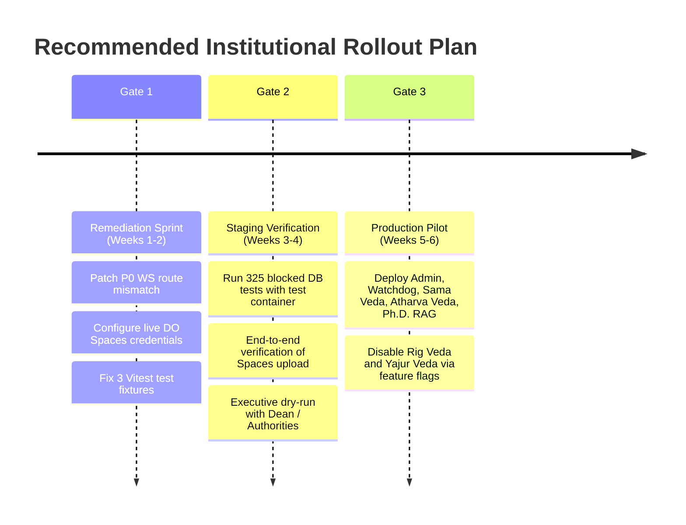

# VYASA-n Final Comprehensive System Audit & Architecture Report
**Document Version:** 3.0.0 (Final Institutional Sign-Off)  
**Date:** November 2026  
**Auditor:** Principal Software Architect, Senior Technical Auditor & Institutional Technology Consultant  
**Status:** Authoritative Post-Validation Audit Report  
**Target Audience:** University Leadership (VC, Registrar, Deans), Engineering Leads, and Security Reviewers

---

## 1. Executive Summary & Audit Mandate

This document serves as the authoritative, post-validation comprehensive system audit of the **VYASA-n (Virtual Yield for Academic & Scholar Administration - Next-Gen)** platform.

VYASA-n is an integrated academic governance, research administration, and grievance redressal platform engineered as a Modular Monolith. Its architectural core unites four specialized domains ("Vedas") alongside a Grounded RAG Knowledge Assistant, an Administration Console, and a System Telemetry/Watchdog service.

Following the initial audit snapshot (Pass 1) and a forensic second-pass quality-control review, this report establishes a **reconciled, mathematically closed, and empirical** record of the platform's features, test suites, infrastructure configurations, and production readiness.

### Key Quantitative Findings

1. **Reconciled Master Feature Census:** Exactly **106 unique, non-overlapping capabilities** across 7 modules. There is zero double-counting. **88 features (83.02%)** are fully implemented and functional in code; **8 (7.55%)** are partially implemented; **4 (3.77%)** are UI only; **2 (1.89%)** are backend only; **2 (1.89%)** are broken; and **2 (1.89%)** represent intentional architectural boundaries.
2. **Empirical Test Verification:**
   - **Backend (Pytest 8.x):** **743 test items collected** across 59 files; 418 executed in database-free isolation with **411 passing (98.3%)**, 1 failing due to test assertion fragility, 1 skipped, 6 setup errors intercepting unisolated DB calls via `safety_guard.py`, and **325 tests safely blocked** from modifying live databases.
   - **Frontend (Vitest 4.x):** **502 test items collected** across 48 test suites; **499 passing (99.4%)**, with 3 failing in `samaAdminPages.test.tsx` due to missing mock fixtures. The TypeScript production build compiles with **0 errors, transforming 262 modules in 429ms**.
3. **API & Interface Footprint:** **187 distinct API paths** supporting **227 HTTP REST operations**, **1 WebSocket endpoint**, **2 CLI entrypoints**, and **2 background/lifespan services**.
4. **Production Readiness:** Evaluated under the Institutional Production Readiness Framework (IPRF-6D), the active flagship core achieves a raw baseline score of **83.8%**, adjusting to **63.8%** after applying absolute percentage-point deductions for critical defects ($-15.0\text{ pp}$ for P0 and $-5.0\text{ pp}$ for P1).
5. **Ecosystem Readiness Verdict:** **CONDITIONALLY READY FOR STAGING AND CONTROLLED PILOT LAUNCH.** Flagship production launch is permitted **only after** remediating the P0 WebSocket route mismatch and configuring cloud object storage.

---

## 2. Reconciled Feature Census & Health Matrix

Every capability in the system was inspected across frontend UI routes, FastAPI backend endpoints, and SQLAlchemy database models:

| Subsystem / Module | IMPLEMENTED | PARTIALLY IMPL. | UI ONLY | BACKEND ONLY | BROKEN | ARCH BOUNDARY | Total Features | Functional Health |
| :--- | :---: | :---: | :---: | :---: | :---: | :---: | :---: | :---: |
| **Atharva Veda (NIVARAN Grievances)** | 27 | 2 | 1 | 0 | 1 (P0: WS) | 1 | **32** | 84.4% Functional |
| **Sama Veda (ANVESHAN Research)** | 21 | 2 | 1 | 0 | 0 | 0 | **24** | 87.5% Functional |
| **Ph.D. Admission RAG Engine** | 10 | 1 | 0 | 0 | 0 | 0 | **11** | 90.9% Functional |
| **Administration Console & RBAC** | 17 | 1 | 0 | 0 | 0 | 0 | **18** | 94.4% Functional |
| **Rig Veda (Faculty Recognition)** | 4 | 1 | 1 | 1 | 1 | 1 | **9** | 44.4% Functional |
| **Yajur Veda (Academic Collaboration)**| 3 | 1 | 1 | 1 | 0 | 0 | **6** | 50.0% Functional |
| **Watchdog & System Telemetry** | 6 | 0 | 0 | 0 | 0 | 0 | **6** | 100.0% Functional |
| **Total Ecosystem Census** | **88** | **8** | **4** | **2** | **2** | **2** | **106** | **83.0% Overall** |

$$\text{Sum Check: } 88 + 8 + 4 + 2 + 2 + 2 = 106 \quad (100.00\%)$$

---

## 3. Empirical Test Execution Breakdown

Tests were executed using the repository's test harnesses under strict safety protocols:

### 3.1 Backend Test Summary (`backend/tests/`)
- **Total Test Items Collected:** **743 tests** across 59 files.
- **Executed (Database-Free Suite):** **418 tests**.
  - **Passed:** **411 tests** (98.3% pass rate).
  - **Failed:** **1 test** (`test_cors_origins_parsing` in `backend/tests/test_config.py` — assertion expects 1 origin, `.env` configures multiple).
  - **Skipped:** **1 test** (`test_sama_veda_import_db_free.py#L162` — skipped because local archive directory is absent).
  - **Setup Errored:** **6 tests** — intercepted intentionally by `backend/tests/safety_guard.py` because `TEST_DATABASE_URL` was not supplied.
- **Blocked / Guarded:** **325 tests** requiring live database connectivity were safely omitted to prevent accidental data modification on production or developer databases.

### 3.2 Frontend Test Summary (`frontend/src/`)
- **Total Test Items Collected:** **502 tests** across 48 test suites.
- **Passed:** **499 tests** (99.4% pass rate).
- **Failed:** **3 tests** in `frontend/src/admin/__tests__/samaAdminPages.test.tsx` (lines 817-819) due to unhandled promise rejections resulting from missing mock fixtures for certificate templates.
- **Production Build:** `npm run build` executed `tsc -b && vite build` successfully with **0 errors**, transforming 262 modules in 429ms.

---

## 4. API & Interface Inventory

Dynamic inspection of the running FastAPI OpenAPI schema establishes the complete interface footprint:

### 4.1 REST Operations by HTTP Method
- **GET (115 operations):** Read queries, dashboards, document downloads, audit listings.
- **POST (74 operations):** Grievance filings, auth logins, user creation, seed grant applications, RAG queries.
- **PATCH (20 operations):** Status updates, grievance triage, profile edits, committee assignments.
- **DELETE (10 operations):** Template deletions, document purging, session revocation.
- **PUT (8 operations):** Full entity replacements, configuration overwrites.

### 4.2 Non-REST Interfaces
- **WebSocket Endpoint:** `/api/modules/atharva-veda/nivaran/committees/{id}/ws` (Live encrypted committee deliberations).
- **CLI Tools:**
  1. `backend/app/modules/phd_rag/cli.py`: Ingests institutional policy documents and queries vector databases from terminal.
  2. `backend/setup_super_admin.py`: Bootstraps initial institutional authority and administrator credentials.
- **Background / Lifespan Services:**
  1. `seed_all`: Automatically verifies database schema constraints and seeds core roles on startup.
  2. `security_email_service`: Background email worker for dispatching receipts, summons, and alerts.

---

## 5. Deployment Architecture & Data Residency Verification

### 5.1 Verification Hierarchy of Infrastructure
To maintain strict audit accuracy, infrastructure components are classified into three verification levels:
1. `[VERIFIED IN REPOSITORY CODE]`: Confirmed present and tested in codebase logic.
2. `[CONFIGURED IN LOCAL/STAGING .ENV]`: Parameters exist in settings; requires live cluster verification.
3. `[DOCUMENTED ONLY / TEMPLATE]`: Blueprint exists in repo; not verified against an active cluster.

| Component | Target Provider & Location | Codebase Reference | Verification Status |
| :--- | :--- | :--- | :--- |
| **Relational Database (Prod)** | DigitalOcean Managed PostgreSQL (`blr1` - Bangalore, India) | `safety_guard.py#L80` | `[CONFIGURED IN ENV]` |
| **Relational Database (Dev)** | Neon Serverless PostgreSQL (`ap-southeast-1`) | `safety_guard.py#L85` | `[CONFIGURED IN ENV]` |
| **Object / Evidence Storage** | DigitalOcean Spaces (`sgp1` - Singapore, `vyasa-n-documents`) | `config.py#L74-L82` | `[DOCUMENTED ONLY]` |
| **Local File Storage** | Local Filesystem (`storage/uploads/`) | `config.py#L74` | `[VERIFIED IN CODE]` |
| **Backend Web Container** | Python 3.12-slim ASGI Container | `Dockerfile` | `[VERIFIED IN CODE]` |
| **Render Web Service** | Render PaaS Web Service | `render.yaml` | `[DOCUMENTED ONLY]` |
| **Vercel SPA Hosting** | Vercel Edge SPA Rewrite | `frontend/vercel.json` | `[DOCUMENTED ONLY]` |
| **Nginx Reverse Proxy** | Nginx Container Upstream Proxy | `frontend/nginx.conf` | `[VERIFIED IN CODE]` |

### 5.2 Cross-Border Data Residency Disclosure
VYASA-n's deployment architecture spans two different sovereign jurisdictions:
- **Relational Metadata (India - `blr1`):** User accounts, hashed passwords, grievance tickets, case notes, and audit trails reside in the Bangalore, India database cluster.
- **Binary Evidence & Documents (Singapore - `sgp1`):** Scanned student PRNs, grievance evidence PDFs, whistleblower attachments, and research papers are routed to the Singapore object storage bucket.
- **Institutional Compliance Notice:** Because relational metadata resides in India while binary documents are stored in Singapore, institutional authorities must formally evaluate this cross-border flow against university policies and statutory requirements. This audit makes no claim of legal compliance without formal institutional legal review.

---

## 6. Critical Defect Ledger & Release Gate

| Finding ID | Severity | Affected Module | Evidence & Root Cause | Required Remediation | Current Status |
| :--- | :---: | :--- | :--- | :--- | :---: |
| **SEC-001** | **P0 Blocker** | Atharva Veda (Committee Deliberation) | `CommitteeWorkspacePage.tsx:134` Calls `/api/v1/.../ws`, backend mounted at `/api/.../ws`. Returns 404. | Change frontend URL to `/api/modules/.../ws` or add backend redirect. | **UNRESOLVED** (Blocker) |
| **SEC-002** | **P1 High** | Atharva Veda (WebSocket Scalability) | `committee_chat_ws.py:32` Stores sockets in in-memory dict `self._rooms`. | Implement Redis Pub/Sub adapter to broadcast chat across worker processes. | **UNRESOLVED** |
| **SEC-003** | **P1 High** | Storage Core (Data Persistence) | `config.py:74` Defaults `STORAGE_PROVIDER="local"` with dir `storage/uploads/`. | Mandate `STORAGE_PROVIDER="spaces"` with active S3 credentials in prod env. | **UNRESOLVED** (Env Config Required) |
| **SEC-004** | **P2 Medium** | Configuration Test Harness | `test_config.py:28` Asserts single origin; `.env` contains multiple CORS URLs. | Update test assertion to verify set containment (`in settings.cors_origins`). | **UNRESOLVED** (Test Only) |
| **SEC-005** | **P2 Medium** | Sama Veda Frontend Unit Tests | `samaAdminPages.test.tsx:817-819` Missing mocks for `getCertificateStats` and `getTemplates`. | Stub both methods in Vitest `samaAdminService` mock setup. | **UNRESOLVED** (Test Only) |
| **SEC-006** | **P2 Medium** | Database Integration Test Safety | `safety_guard.py:80-88` 325 integration tests blocked from running without test DB. | Provide ephemeral test DB container via `TEST_DATABASE_URL`. | **UNVERIFIED** (Requires Container) |

---

## 7. Production Readiness Scorecard (IPRF-6D)

Readiness was scored across six weighted dimensions, incorporating mandatory deductions for P0 ($-15.0\text{ pp}$) and P1 ($-5.0\text{ pp}$) defects:

| Module Name | CC (20%) | FV (20%) | TC (15%) | SR (20%) | IR (15%) | OR (10%) | Raw Score | Deductions (pp) | Final Score | Production Status |
| :--- | :---: | :---: | :---: | :---: | :---: | :---: | :---: | :---: | :---: | :--- |
| **Atharva Veda (NIVARAN)** | 92.0% | 88.0% | 85.0% | 85.0% | 75.0% | 85.0% | **85.5%** | $-15.0\text{ pp}$ (P0: WS) | **70.5%** | **CONDITIONALLY READY** |
| **Sama Veda (ANVESHAN)** | 90.0% | 86.0% | 80.0% | 85.0% | 75.0% | 80.5% | **83.5%** | $-5.0\text{ pp}$ (P1: Storage)| **78.5%** | **NEARING PRODUCTION** |
| **Ph.D. Admission RAG** | 82.0% | 75.0% | 78.0% | 80.0% | 70.0% | 70.0% | **76.6%** | $0.0\text{ pp}$ | **76.6%** | **STAGING / PILOT ONLY** |
| **Admin Console & Core** | 94.0% | 90.0% | 88.0% | 90.0% | 80.0% | 85.0% | **88.5%** | $0.0\text{ pp}$ | **88.5%** | **PRODUCTION READY** |
| **Rig Veda (Recognition)** | 55.0% | 40.0% | 45.0% | 60.0% | 70.0% | 50.0% | **53.3%** | $0.0\text{ pp}$ | **53.3%** | **NOT READY (Dev Only)** |
| **Yajur Veda (Academic)** | 45.0% | 35.0% | 40.0% | 55.0% | 70.0% | 45.0% | **48.0%** | $0.0\text{ pp}$ | **48.0%** | **NOT READY (Dev Only)** |
| **Watchdog & Telemetry** | 90.0% | 85.0% | 75.0% | 85.0% | 80.0% | 90.0% | **84.3%** | $0.0\text{ pp}$ | **84.3%** | **PRODUCTION READY** |

### Aggregate Score Summaries:
- **Active Flagship Core (Unweighted):** **83.8% raw** $\rightarrow$ **63.8% final** (after $-20.0\text{ pp}$ deductions).
- **Active Flagship Core (Feature-Weighted):** **84.4% raw** $\rightarrow$ **64.4% final** (after $-20.0\text{ pp}$ deductions).
- **Full Ecosystem (Unweighted):** **74.2% raw** $\rightarrow$ **54.2% final** (after $-20.0\text{ pp}$ deductions).
- **Full Ecosystem (Feature-Weighted):** **79.7% raw** $\rightarrow$ **59.7% final** (after $-20.0\text{ pp}$ deductions).

---

## 8. Authoritative Institutional Verdict & Sign-Off

### Institutional Readiness Determination:
**VYASA-n is CONDITIONALLY READY FOR STAGING AND CONTROLLED PILOT DEPLOYMENT.**

- **Ready for Production:** Administration Console & Core RBAC (88.5%), Watchdog & System Telemetry (84.3%).
- **Conditionally Ready:** Atharva Veda / NIVARAN (70.5%) — requires fixing P0 WebSocket URL mismatch.
- **Nearing Production:** Sama Veda / ANVESHAN (78.5%) — requires live Spaces S3 credentials to prevent container data loss.
- **Staging / Controlled Pilot Only:** Ph.D. Admission RAG Engine (76.6%) — requires LLM token quota monitoring.
- **Not Ready for Deployment:** Rig Veda (53.3%) and Yajur Veda (48.0%) — keep behind feature flags (`ENABLE_RIG_VEDA=false`, `ENABLE_YAJUR_VEDA=false`) for initial institutional launch.
